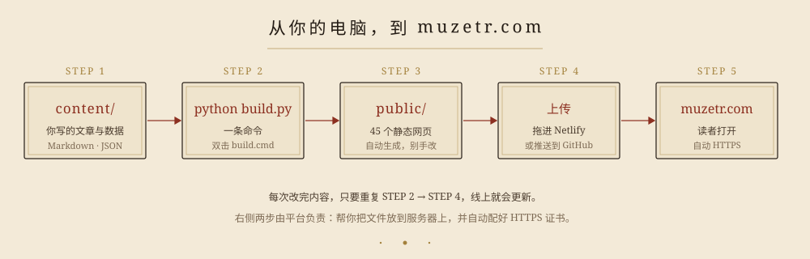
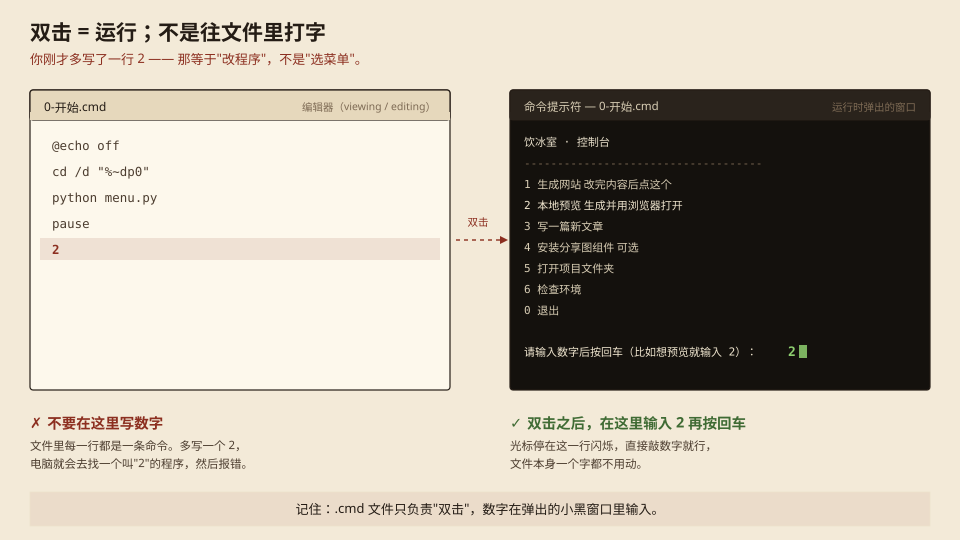
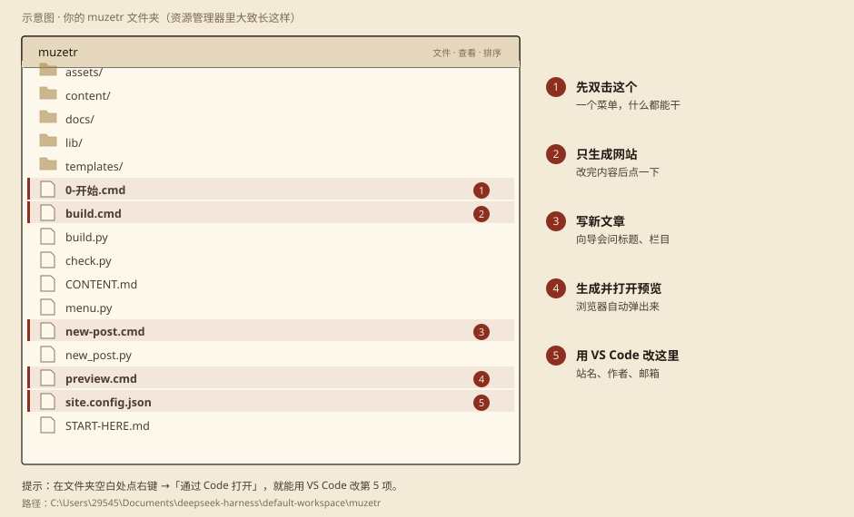

# 新手手册 · 从这里开始

> 这份手册假设你**没有写过代码、没用过终端、也没有 GitHub 账号**。
> 每一步都能直接照做，做不下去就把报错整段复制给我。
>
> 建议顺序：**第 0 天只做 1–3 章**（把网站跑起来、改成自己的），
> **第 2 天再做第 4 章**（上线到 muzetr.com）。不要想着一晚上全做完。



---

## 0. 先看懂四件事（3 分钟，别跳过）

### ① 这个网站只是「一堆文件」

你的网站 = 45 个 HTML 文件 + 一些图片、样式、脚本。没有数据库，没有后台程序。
所谓「上线」，就是**把这堆文件放到一台永远开着的电脑上（服务器），让别人能访问**。

### ② 有两个文件夹，别搞混

| 文件夹 | 是什么 | 你要做的事 |
| --- | --- | --- |
| `content/` | **手稿**：你的文章、碎碎念、收藏清单 | ✅ 日常只改这里 |
| `public/` | **印好的书**：程序生成的成品网页 | ❌ 别手改，每次生成都会被覆盖 |

`build.py` 就是印刷机：把 `content/` 里的手稿，排成 `public/` 里的一本本书。
所以你改完内容，**必须重新"印"一次**（双击 `build.cmd`），改动才会出现。

### ③ 你只需要记住两个动作

- **写**：改 `content/` 里的文件
- **印**：双击 `build.cmd`，然后双击 `preview.cmd` 看效果

### ④ 你的域名现在还没指向这个网站

我查过了：

| 项目 | 现在的情况 |
| --- | --- |
| 域名 | `muzetr.com`，已注册，**2027-07-15 到期**（记得续费） |
| 注册商 | Nics Telekomunikasyon A.S.（就是 **natro.com**，土耳其服务商） |
| 域名服务器 | `ns1.natrohost.com` / `ns2.natrohost.com` |
| 现在打开是什么 | Natro 的「域名停放页」（一个土耳其语的占位页面） |

意思是：域名现在是活的，但**还没接到你的网站上**。第 4 章教你怎么接。

---

## 1. 准备工具（一次性，约 15 分钟）

### 1.1 Python —— 已经装好了 ✅

你这台电脑已经有 Python 3.15.2，直接能用。想确认的话，按 `Win + R`，输入 `cmd` 回车，然后输入：

```bat
python --version
```

看到 `Python 3.15.2` 就对了。

> 如果哪天换了电脑，去 <https://www.python.org/downloads/> 下载安装，
> 安装第一屏**一定要勾选 `Add python.exe to PATH`**，否则命令行找不到它。

### 1.2 装一个写字的编辑器：VS Code（强烈建议）

用记事本改 JSON 很容易改坏（少个逗号、编码变了）。VS Code 免费、轻量、中文界面。

1. 打开 <https://code.visualstudio.com/> → 点 **Download for Windows**
2. 双击安装包，一路「下一步」，到 **"添加到 PATH"** 那一步保持勾选
3. 装完后：右键你的项目文件夹 `muzetr` → **「通过 Code 打开」**

以后改任何文件：在左边文件列表点开 → 改 → `Ctrl + S` 保存。

### 1.3 可选：让每篇文章有自己的分享图

装好 VS Code 后，双击 `0-开始.cmd`，按 **4**，它会自动帮你装好 Pillow（需要联网十几秒）。

装了之后，每篇文章会生成一张 1200×630 的分享卡片（发到微信/推特时显示的那张图）。
不装也不影响网站，只是分享时用统一的默认图。

（如果你更喜欢自己敲命令：`python -m pip install pillow`）

### 1.4 第二阶段才装：Git

第 4 章走 GitHub 路线时才需要。现在先不管。

---

## 2. 第一次把网站跑起来（5 分钟）

> ⚠️ **先记住一件事：`.cmd` 文件只用来"双击"，不要打开它改内容。**
> 双击之后会弹出一个黑窗口，数字要**在那个窗口里输入**，而不是写进文件里。
>
> 



### 2.1 找到项目文件夹

地址是：

```
C:\Users\29545\Documents\deepseek-harness\default-workspace\muzetr
```

打开它之后，你只需要记住一个文件：**`0-开始.cmd`**（排在最上面，名字以 0 开头）。
双击它会出现一个中文菜单，所有操作都能在这里点：

```
1  生成网站          改完内容后点这个
2  本地预览          生成并用浏览器打开
3  写一篇新文章
4  安装分享图组件    可选，装一次就够
5  打开项目文件夹
6  检查环境
0  退出
```

> 懒人用法：双击之后**什么都不用输，直接按回车**，等于选了 2（预览）。
> 或者干脆双击 `preview.cmd`，一步到位。

其余文件的作用：

```
0-开始.cmd        ← 总入口，先双击这个
build.cmd         ← 只生成网站
preview.cmd       ← 生成并打开预览
new-post.cmd      ← 写新文章
site.config.json  ← 站名、作者、邮箱（用 VS Code 改）
content/          ← 你的内容
public/           ← 生成出来的成品
```

> **小技巧**：右键 `muzetr` 文件夹 → 「发送到」→「桌面快捷方式」。
> 以后从桌面双击就能进。

### 2.2 生成网站

双击 **`0-开始.cmd`**，输入 **1** 回车（或者直接双击 `build.cmd`）。

会弹出一个黑窗口，几秒后显示类似：

```
饮冰室 · build complete → ...\muzetr\public
  页面 45 · 文章 7 · 碎碎念 14 · 收藏 16 · 作品 5 · 标签 18
  产物 0.9 MB
```

看到「页面 45」就成功了。按回车回到菜单。

### 2.3 本地预览

在菜单里输入 **2** 回车。它会先生成，再启动一个小服务器，并且**自动打开浏览器**。

浏览器地址是 `http://127.0.0.1:8000` —— 这就是你的网站，在你自己的电脑上跑着，
全世界只有你能看到。看完在那个黑窗口按 **Ctrl+C** 就停止了。

> **为什么改完没变化？** 两个原因：忘了重新生成（先跑 `build.cmd`），或者浏览器缓存。
> 按 **`Ctrl + F5`** 强制刷新。

### 2.4 如果这里有报错

| 窗口里出现 | 原因 | 解决 |
| --- | --- | --- |
| `'python' 不是内部或外部命令` | Python 没加进 PATH | 重装 Python，勾选 Add to PATH |
| 中文变成一堆问号/方块 | 终端编码问题，不影响网站 | 忽略；或改用 `build.cmd`（里面已处理） |
| `Address already in use` | 8000 端口被别的程序占了 | 脚本会自动换 8001、8002…，看窗口里提示的地址 |
| 一堆红字 + `Traceback` | 某个内容文件格式写错了 | 把整段红字复制给我 |

---

## 3. 改成你自己的（约 30 分钟，最重要的一章）

### 3.1 先改这 6 个地方

用 VS Code 打开 `site.config.json`，改这几行，改完 `Ctrl+S`：

```json
{
  "domain": "muzetr.com",
  "baseUrl": "https://muzetr.com",
  "title": "饮冰室",
  "titleEn": "The Ice-Drinking Room",
  "motto": "朝受命而夕饮冰，我其内热与。",
  "author": {
    "name": "饮冰室主人",          ← 换成你的名字或笔名
    "handle": "@muzetr",
    "email": "hello@muzetr.com"   ← 换成你常用的邮箱
  }
}
```

注意：
- JSON 里每一项之间用 **英文逗号** `,` 隔开，最后一项**不要**逗号。
- 引号必须是**英文引号** `"`，不是中文引号 `“”`。
- 改错了不要紧，`build.cmd` 会报错并告诉你在第几行。

改完双击 `build.cmd`，再双击 `preview.cmd`，看左上角的站名是不是变了。

### 3.2 写第一篇文章（推荐用向导）

双击 **`0-开始.cmd`** 输入 **3**（或直接双击 `new-post.cmd`），它会把问题一条条问你：

```
文章标题： 我的第一篇文章
文章放哪个栏目？ 1
标签（多个用逗号隔开，可留空）： 随笔, 开始
摘要（一句话，可留空）： 记录这个站开张的第一天。
网址用的英文短名： my-first-post
这篇文章要加密吗？ y/n： n
```

回车之后，它会：
1. 在 `content/posts/` 里建好 `my-first-post.md`
2. 自动用 VS Code（或记事本）打开它
3. 问你要不要顺手生成网站

文件里已经写好了骨架，你只要把正文替换成自己的字，保存，然后生成即可。

> 网址就是 `muzetr.com/posts/my-first-post/`。短名以后别改，改了旧链接就失效了。

### 3.3 加一条碎碎念

打开 `content/notes.json`，在最前面加一条（注意逗号）：

```json
[
  {
    "date": "2026-11-17",
    "text": "今天把网站弄上线了，居然比想象中容易。",
    "tags": ["building"]
  },
  ...（后面原有的内容保持不变）
]
```

`tags` 决定页面顶部会出现哪些筛选按钮，随便写，英文小写最好看。

### 3.4 改「关于」页

打开 `content/about.json`：

- `intro`：两段自我介绍（第一段的第一个字会自动放大）
- `now`：此刻在读 / 在听 / 在学 / 在修
- `timeline`：年表，一年可以多条
- `skills`：手艺分组
- `contacts`：邮箱、GitHub 等

### 3.5 换配色（可选）

打开 `assets/css/site.css`，最上面几行：

```css
:root {
  --paper: #f3ead8;    /* 纸张底色 */
  --ink: #241c15;      /* 墨色（正文） */
  --accent: #8c2f20;   /* 朱红（强调） */
  --accent-2: #a3813c; /* 烫金 */
}
```

把 `--paper` 改成 `#ffffff` 就是纯白极简风，改成 `#f5efe3` 更暖。
改完记得重新生成。

### 3.6 每次改完的固定动作

```
1. 保存文件（Ctrl+S）
2. 双击 build.cmd
3. 双击 preview.cmd
4. 浏览器里 Ctrl+F5 看一眼
```

---

## 4. 上线（已经做完了，这章是存档）

> **现状（2026-11-17）**：网站已经上线在 **<https://muzetr123.netlify.app>**，
> 用 Netlify Drop 拖拽部署，没花一分钱。下面的内容是"当时怎么做的"和"以后想换域名怎么做"。

### 4.1 每次更新的固定动作

1. 双击桌面 **⑤ 更新到网站**（自动生成 + 打包 + 打开上传页）
2. 把桌面上的 `muzetr网站.zip` 拖进虚线框
3. 等它跑完、变绿就更新好了

免费额度：每月 100 GB 流量、300 分钟构建时间，个人站完全够用。

### 4.2 网址和站点名

- 你的网址 = **站点名 + `.netlify.app`**，现在是 `muzetr123.netlify.app`
- 改名：**Site configuration → General → Site name**
- ⚠️ 改名后**旧网址会立刻失效**（Netlify 不做跳转），所以要告诉朋友新地址

### 4.3 关于 muzetr.com（重要，别再折腾它）

- 我查过注册信息：`muzetr.com` 于 **2026-07-15** 注册，注册商 Natro，**2027-07-15 到期**
- 你在 Natro 的公开查询页看到"已被注册"，说明它**不在你名下**（页面不显示主人是谁）
- 如果域名不是你的，你就**改不了它的 DNS**，也就不能把它指到你的网站
- 所以现在不用它，用 Netlify 的免费网址就好。Netlify 里那条 `muzetr.com` 的 Pending 记录可以删掉

### 4.4 以后想用自己的域名（可选）

**买一个新域名**（推荐，一年几十块）：

1. 在任意注册商买（阿里云、腾讯云、Namecheap、Cloudflare 都行）
2. Netlify → **Domain management** → **Add a domain** → 输入你的域名
3. 按它给的提示，去域名商那里加两条记录：

   | 类型 | 主机 | 值 |
   | --- | --- | --- |
   | `A` | `@` | `75.2.60.5` |
   | `CNAME` | `www` | `muzetr123.netlify.app` |

4. 等 10 分钟～24 小时，Netlify 会自动签好 HTTPS 证书
5. 回到我的配置里，把 `site.config.json` 的 `domain` 和 `baseUrl` 改成新域名，重新生成并上传

> 网站内容一个字都不用改，域名只是"门牌号"。真正想用回 `muzetr.com`，只能联系现在的持有人买，不建议。

### 4.5 要不要用 GitHub 备份？

不是必须的。备份最简单的办法就是**把整个 `muzetr` 文件夹复制一份到网盘**（见第 10 章）。
等你以后想让别人也能帮忙改、或者想要版本历史，再学 GitHub 也不迟。

## 5. 日常写作流程（熟练后 3 分钟）

```
双击 0-开始.cmd → 3 写文章 → 写正文、Ctrl+S → 回菜单 → 1 生成 → 2 预览
     ↓
发布：Netlify 重新拖 public ／ 或者双击 publish.cmd
```

改碎碎念、收藏这类数据，就是「用 VS Code 打开 JSON → 改 → 保存 → build」。

**养成习惯**：每次只改一小步就 preview 一次，出问题立刻知道是哪一步改坏的。

---

## 5.5 加图片、视频、音乐

### 最简单的方式：双击桌面「⑥ 加图片或视频」

1. 双击 **⑥**，会弹出一个选文件的窗口
2. 选中你的图片（或视频、音乐），点"打开"
3. 它会自动做三件事：
   - 把文件复制到正确的目录（图片进 `assets/img/posts/`，影音进 `assets/media/`）
   - 在窗口里给你**一行代码**，并且已经帮你复制好了
   - 告诉你要粘贴到哪里
4. 双击 **④ 继续改刚才那篇**，在文章里想放图片的位置按 **`Ctrl + V`** 粘贴
5. `Ctrl + S` 保存 → 双击 **⑤** → 把 zip 拖上去

### 那行代码长什么样

**图片**（鼠标显示的是你填的图说）：

```markdown

```

**本地视频**：

```html
<video controls preload="metadata" src="/assets/media/wo-de-shipin.mp4"></video>
```

**B 站视频**（推荐，省流量、国内快）：在 B 站视频页复制 BV 号，然后：

```html
<iframe src="//player.bilibili.com/player.html?bvid=BV1xx411c7mD&autoplay=0" allowfullscreen></iframe>
```

### 体积建议（这条很重要）

| 类型 | 建议 | 太大会怎样 |
| --- | --- | --- |
| 图片 | 单张压到 **1 MB 以内** | 手机照片常有 3–5 MB，网页会变慢、加载久 |
| 视频 | 超过 **20 MB** 就传 B 站 | 你的网站包会变得巨大，拖拽上传会失败 |

**怎么压图**：手机拍的照片，用微信"发给自己"再保存，就会压到几百 KB；或者打开 <https://squoosh.app>（免费，拖进去就行）。

---

## 6. 备份与安全（别省这一步）

### 备份

最省事的备份就是 **`content` 文件夹**——那里的文字才是你的东西，
`templates/` 和 `assets/` 我已经给过你一份，丢了也能恢复。

- 每周把 `content` 文件夹复制一份到网盘（OneDrive / iCloud / 百度网盘都行）
- 或者走 GitHub 路线，代码天然有版本历史

### 私密文章的口令

加密文章的正文确实是密文，**但口令写在 `.md` 文件里**。
如果你把仓库设成公开，别人翻源码就能看到口令。所以：

- 公开仓库：只用示例口令玩玩，别放假秘密
- 真要保密：仓库设私有 + 用 Netlify（免费账号支持私有仓库），或者干脆别放上来

### 别做的事

- ❌ 不要把 `public/` 里的文件直接改（下次生成就没了）
- ❌ 不要改 `templates/` 里的文件名
- ❌ 不要用记事本存中文 JSON（编码会变）

---

## 7. 出问题先查这张表

| 现象 | 最可能的原因 | 怎么办 |
| --- | --- | --- |
| 改了内容，浏览器没变 | 忘了 build，或浏览器缓存 | `build.cmd` → `Ctrl+F5` |
| `'python' 不是内部或外部命令` | PATH 没配 | 重装 Python 勾选 Add to PATH |
| 红字 `JSONDecodeError: line 12` | JSON 第 12 行少了逗号/引号 | 去那一行补上英文逗号 |
| 中文变乱码 | 文件不是 UTF-8 保存 | VS Code 右下角点编码 → 选 UTF-8 → 另存 |
| 文章没出现 | 文件名以 `_` 开头 / 日期格式不对 / 没 build | 检查 `date: 2026-11-17` 格式 |
| 首页「精选」空着 | 没有文章设 `featured: true` | 改一篇文章的 frontmatter |
| 图片不显示 | 路径写错或大小写不符 | 图片放 `assets/img/posts/`，路径写 `/assets/img/posts/xxx.jpg` |
| 端口被占用 | 别的程序占了 8000 | 看 preview 窗口提示的实际端口 |
| 域名打开还是停放页 | DNS 没改成功 / 还没生效 | `nslookup -type=ns` 看，等 2 小时 |
| 线上 404，本地正常 | 拖错了文件夹（拖成了 muzetr） | 重新拖 `public` |
| HTTPS 有警告 | 证书还没签发完 | 等 10 分钟，或在平台点「Renew certificate」 |
| 双击 `.cmd` 打开的是编辑器，不是黑窗口 | 文件关联被改成了编辑器 | 右键那个文件 →「打开」；或按 `Win+R` 输入 `cmd`，把文件拖进去回车 |
| 窗口里报 `'2' 不是内部或外部命令` | 把数字写进了 `.cmd` 文件里 | 把那行删掉，双击运行后在窗口里输入 |
| 双击后窗口一闪就没 | 脚本执行完就退出了（正常） | 用 `0-开始.cmd`，它结尾有暂停，不会闪退 |

**求助时请给我三样东西**：① 你做了什么 ② 完整报错文字 ③ 屏幕截图。

---

## 8. 名词小词典

| 词 | 一句话解释 |
| --- | --- |
| 终端 / 命令行 | 用打字代替点鼠标操作电脑的窗口（`cmd` / PowerShell） |
| PATH | 电脑找程序的目录清单，Python 不在里面就打不开 |
| Markdown | 用 `## 标题`、`**加粗**` 这种符号写文章的格式，`.md` 文件 |
| frontmatter | Markdown 文件开头两条 `---` 之间的设置区（标题、日期、标签） |
| JSON | 一种数据格式，用 `{}` 和 `[]` 组织，注意英文逗号 |
| 静态网站 | 没有数据库、每次访问都返回同样文件的网站（快、便宜、不易坏） |
| 构建 / build | 把 content 里的手稿"印刷"成 public 里的网页 |
| 部署 / 上线 | 把 public 里的文件放到服务器上，让别人能访问 |
| 仓库 / repository | GitHub 上存放代码的文件夹，自带历史记录 |
| commit / push | 把改动"存一次档" / "传到 GitHub 上" |
| DNS | 把域名翻译成服务器地址的电话簿 |
| NS（域名服务器） | 谁的 DNS 说了算；换 NS 等于把电话簿交给新公司管 |
| A 记录 | 域名 → 一个 IP 地址 |
| CNAME | 域名 → 另一个域名（别名） |
| HTTPS / 证书 | 浏览器地址栏那把锁；Netlify 和 GitHub 都会自动配 |

---

## 9. 以后想加什么（随时找我）
- **评论**：接 Giscus（本站留言板已经预留了开关，在 `site.config.json`）
- **相册**：把照片放 `assets/img/`，我加一个瀑布流页面
- **访问统计**：GoatCounter / Umami，不用 Cookie
- **邮件订阅**：Buttondown / follow.it
- **音乐**：首页放一个播放器，读你放在 `assets/audio/` 里的 mp3
- **更多栏目**：读书笔记、周报、书目

---

## 10. 长期维护（一年其实只需做几件小事）

| 多久一次 | 做什么 | 为什么 |
| --- | --- | --- |
| 每次写完 | 双击 ⑤ → 拖 zip | 线上才会更新 |
| 每月一次 | **把整个 `muzetr` 文件夹复制一份**到网盘或 U 盘 | 这是唯一的风险点：电脑坏了，你的文字就没了 |
| 想起时 | 看 `content/` 里有没有想删的旧草稿 | 保持干净 |
| 一年 | 域名续费（如果以后买了域名） | 忘了续费域名会被别人抢走 |

**关于备份**：`public/` 是生成的，不用备份；`content/` 是你的字，一定要备份。
最省事：把这个文件夹整个拖进 OneDrive / 百度网盘同步目录。

**关于费用**：Netlify 免费额度每月 100 GB 流量，个人站基本用不完；图片视频别放太大就行。

**关于网址**：现在是 `muzetr123.netlify.app`。哪天想换成自己的域名（比如 `muzetr.com`），随时可以做，网站内容一个字都不用改。

---

## 最后

这份手册里的每一步我都尽量写成"照着做就行"。但每个人的电脑都不一样，
**卡住的地方直接截图问我**，不用自己硬扛。

网站是可以慢慢长出来的东西。先让 `muzetr.com` 能打开、能写第一篇文章，
剩下的以后再说。
