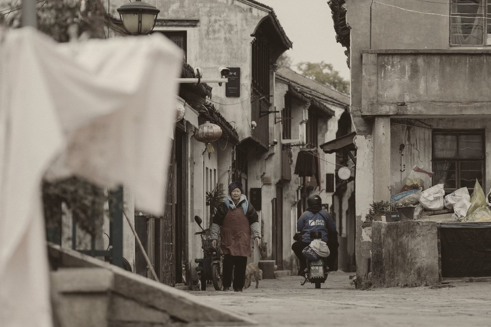

我从来没想到，我会用整整一个暑假，去学一门早就被全家人默契地“遗忘”了的语言。那是我奶奶的方言。一种除了她，和我们那个早已搬空的村子，再没人说、也再没人愿意听的话。可最后，正是这门土得掉渣的话，把我从一团乱麻的生活里，捞了出来。

## 一、暑假的流放

我妈把我塞进长途汽车的时候，语气像在处理一件过期快递：“你奶奶一个人，腿脚不好，你去陪她住一个月。生活费放抽屉里了，省着点花。”

车开动那一刻，我从后视镜里看见她已经开始打电话谈业务，西装裙迈得飞快。得，亲妈。

我叫林一凡，十七岁，刚上完高二。成绩中游，爱好是打游戏和刷短视频，理想是考上个大学然后离我妈远远的。我爸妈在我十二岁时离的婚，我跟我妈。我妈是那种能把日子过成KPI的女人——精确到每一分钟该干什么，误差超过五分钟就暴躁。早上六点半起床，七点出门，路上听财经播客，中午吃沙拉，晚上加班到九点，周末还要上什么“时间管理训练营”。她手机里有个表格，连我多久剪一次头发都标着红黄绿。红色是“逾期”，黄色是“临近”，绿色是“正常”。我上个月头发长到盖耳朵，她给我发了条微信：“林一凡，你头发的KPI已经红了。”

而我爸？离婚后去了南方，一年打两个电话，开口就是“儿子啊，爸最近项目紧”。去年我生日他发了个红包，备注“买点学习资料”。我点开一看，八十八块八。我回了个“谢谢爸”，转手充了游戏点卡。

至于我奶奶——说实话，我对她没什么印象。上次见她还是三年前春节，全家回去待了两天。她说话我只能听懂三成，剩下的全靠我妈现场翻译：“你奶奶问你饿不饿”“你奶奶让你多穿点”。我妈翻译的时候永远皱着眉，好像这门方言自带什么脏东西。我爸在旁边讪笑：“妈，说普通话，孩子听不懂。”

奶奶就抿着嘴笑，眼角的皱纹堆成一把折扇，然后继续用她那土得掉渣的话絮叨。全村就剩不到十个老人，平时大概只有鸡和狗听她说话。

现在，轮到我一个人去听她说话了。

汽车下了高速，拐进一条柏油都快褪成白色的乡道，又开了四十分钟，在一个长满野草的站牌前停下。我拖着箱子下来，手机信号从4G掉到E，最后直接没了。站牌上写着“柳树屯”，字掉了一半，只剩“木卯屯”。一只瘦骨嶙峋的黄狗蹲在牌子底下舔爪子，抬眼看了我一下，连叫都懒得叫。

奶奶站在村口那棵歪脖子枣树下等我。她比三年前更瘦了，一件洗得发白的碎花棉布衫，裤腿挽到脚脖子，露出静脉曲张的腿。头发全白了，在脑后绾成一个小髻，用一根黑卡子别着。看见我，她先是愣了两秒，然后快步过来，嘴里噼里啪啦蹦出一串话——

“俺滴乖乖嘞！咋瘦成个猴了？你妈是不是不给你吃饭？快快快，家里炖了鸡……”

我一个字没听懂。但“乖乖”和“鸡”我听出来了。我尴尬地笑了笑：“奶奶好。”

她明显顿了一下，然后改用一种极其蹩脚的普通话，一个字一个字往外挤：“你——饿——不——饿？”那个“饿”字发音像“卧”。

我赶紧点头：“饿。奶奶你别说普通话了，你累我也累。”

她好像松了口气，又开始叽里咕噜。我像个聋子一样跟在她身后，穿过晒满玉米的场院，几只土狗冲我叫了两声就被她喝走了。整个村子安静得能听见蝉蜕壳的咔嚓声。家家户户门锁生锈，墙上喷着大红的“拆”字，但没一户还在住人了——都搬去镇上或者县城了。就剩我奶奶，还有村东头一个聋了三十年的老光棍，叫老闷。老闷养了七只羊，每天赶着羊从奶奶家门口过，两人互相点个头，一句话不说。一个聋，一个说了也没人听，倒也挺和谐。

推开她家院门，扑面一股艾草和霉味混合的气息。堂屋正墙上挂着我爷爷的黑白遗像，旁边是我小学时候的奖状——都黄得看不清字了。一张八仙桌，四条长凳，一台雪花牌冰箱嗡嗡响，像随时要断气。我把自己扔在竹凉席上，开始后悔没带充电宝。

## 二、头三天，全靠比划

头三天，我跟我奶奶的生活基本靠比划。

她想让我吃第二碗饭，就拍拍自己肚子再指指锅；我想洗澡，就做一个搓澡的动作，她恍然大悟，去灶上烧一大锅热水，拎着往塑料洗澡帐里倒。晚上她要看电视，遥控器上全是字，她老花眼按不准，我帮她调台。她爱看地方戏曲频道，咿咿呀呀唱得我头皮发麻，我忍了五分钟就溜回屋玩手机。

手机没电了，充电器又找不着。我翻遍背包，发现走之前我妈给我塞了个充电宝，但充电宝也没电。我问奶奶家里有没有插座，她把我领到冰箱旁边，指着墙上一个两孔插座，上面插着冰箱插头。我拔了冰箱，插上充电器，充了十分钟，奶奶从灶房跑出来，一脸惊慌：“哎哎哎！冰箱！冰箱！”我这才明白，冰箱不能断电，里面还有半扇猪肉。我赶紧换回去。她又比划半天，意思是让我去村口小卖部借插排。我走了二里地，小卖部关门，门口贴张纸：“有事打电话，138xxxx”。我没信号，打不了。回来路上碰见老闷赶羊，他看我举着手机满村找信号，咧嘴笑了，露出一口黄牙，指了指村后山坡：“那儿，高，有信号。”我爬了二十分钟，终于在两格信号下给我妈发了条微信：“充电器没带，速寄。”她秒回：“自己想办法。锻炼独立能力。”我差点把手机扔下山坡。

第四天晚上，我把手机玩没电了，充电器又找不着。百无聊赖，开始翻她屋里那个樟木箱子。箱子没锁，一掀盖子，樟脑丸味儿呛得我连打三个喷嚏。

里面全是旧东西：我爷爷的退伍证，我爸小时候的作业本（字丑得像狗爬），几块印花布，一沓粮票，还有一本手抄的、用鞋底线装订起来的厚本子，牛皮纸封面，用圆珠笔写着四个歪歪扭扭的字——

《俺村土话》

翻开第一页：

“挨帮儿——刚才” “夜个儿——昨天” “前晌——上午” “黑价——晚上” “得济——得到好处，多指儿女孝顺” “埋汰——脏” “嘎咕——坏，不好” “膈应——恶心人” “波棱盖儿——膝盖” “打平伙——大家凑钱吃饭” “焖燥——闷热” “野了——疯跑不回家” “笤帚疙瘩——扫帚把儿，也指揍孩子的工具” “火钩子——捅炉子的铁钩，也指家法”

字迹有两种。前半本歪歪扭扭，像小学生写的；后半本逐渐变得流畅工整，还有红笔标注的拼音和例句。每一页右上角都编了号，从一编到三百六十七。中间夹着一张发黄的照片：一个扎两条辫子的年轻女人，怀里抱着个穿开裆裤的男娃，背景是村口那座石桥。照片背面用圆珠笔写着：“秀兰和建国，1981年秋。”

秀兰是我奶奶的名字。建国是我爸。

翻到第五十二页，底下还有一行小字：“今天学‘打平伙’——大家凑钱吃饭。俺请隔壁二婶教了八遍。她笑话俺舌头硬。俺不生气，俺多练。”

我一下坐直了。

## 三、奶奶的秘密

第二天吃早饭，我举着那本词典，磕磕巴巴用刚学的方言问她：“奶，这……是你写的？”

她正在灶台前烙饼，回头瞅了一眼，脸上表情像被踩了尾巴的猫——又惊又窘。她快步过来把本子抢过去，在围裙上擦了擦手，嘴里嘟囔：“哎哟这破烂玩意儿你还翻出来了……写得孬，别看了。”

“不孬！写得好。”我故意用方言说。就俩词儿，说得跟外国人似的。

她扑哧笑了，露出两颗镶过的银牙。然后她搬个小马扎坐下，一边擀饼一边给我讲。

“俺嫁过来那年，十九。你爷爷是部队退伍回来的，在村里当会计，算盘打得噼啪响。俺娘家在三十里地外的赵庄，口音跟这儿不一样。头一个月，俺连门都不敢出。”

“为啥？”

“丢人呗。”她把饼往锅里一贴，滋啦一声，“上井台打水，人家说‘你先把桶涮涮’，俺听成‘你先把桶攥攥’，俺就攥着桶把儿使劲儿攥，人家笑得直不起腰。还有一回，生产队分瓜，会计喊‘秀兰家的，你家三斤半’，俺听成‘你家三斤半的——’，俺寻思俺家也没三斤半的啥东西啊，就站那儿发愣。后来你爷爷回家跟俺学，俺才明白是咋回事。”

“俺爷爷笑你了吗？”

“他不笑。他拿张纸，把人家的话一个字一个字写下来，旁边注上俺娘家那边咋说。他说：‘秀兰，你脑子好使，学得快。’”奶奶用擀面杖敲了敲案板，“就这句话，俺记了一辈子。”

“后来呢？”

“后来俺就发狠学。每天揣个小本本，听人家说一句，记一句。下地干活听，赶集听，谁家娶媳妇吃席听。俺闺女时候记了两百多句，后来嫁过来头三年又记了一百多句。不会写的字就问建国他爹，他上过完小，会写。”

她指了指那本词典：“后半截那些字工整的，都是他帮俺抄的。”

我翻开后半本，果然字迹变了，钢笔写的，一笔一划像印刷体。旁边还有红笔批注：“此处应作‘不得劲儿’，非‘不的劲’。”

“俺爷爷帮你抄的？”

“嗯。他抄完了还跟俺说：‘秀兰，你这是给咱村修了本字典啊。往后谁家新媳妇嫁过来，看这个就能学会说话。’”

她说到这里，突然不吭声了，低头使劲擀饼。我注意到她右手小指是弯的，伸不直。我爸说过，那是早年干农活被机器夹的。

“奶，你恨不恨当初没人教你？”

她想了想，把擀面杖放下，用围裙擦了擦手：“恨啥？人家也不是故意的。那时候都穷，都忙，谁顾得上教你说话？俺就是觉得……话这东西，你学不会，就跟人隔着一层玻璃。看得见人家笑，听不见人家为啥笑。俺不想隔玻璃。”

## 四、一个月，一门语言

从那天起，我决定干一件大事：把这本词典从头到尾学一遍。

不为别的，就为了能跟我奶奶正常说句话。顺便——我承认——我实在太无聊了。手机没信号，短视频刷不出来，游戏掉线到队友骂娘。与其躺床上长毛，不如学点东西。

我制定了个计划：每天学十个词，晚上用新学的词跟奶奶聊天。她当考官，我说错了她就拿擀面杖敲我脑门——轻轻的。

头一个星期惨不忍睹。

我说“夜个儿”，发音像“夜壶儿”，奶奶笑得直拍大腿：“啥壶？你才是个夜壶！”

我说“膈应”，说成“各应”，奶奶纠正：“是膈应，四声！你那嘴跟借来的似的，舍不得用劲儿。”

我说“波棱盖儿”，说成“菠萝盖”，奶奶笑得直咳嗽：“你当是吃菠萝呢？波棱盖儿！舌头卷一下！”

我学“得济”，问她：“奶，俺算不算得济？”她拿擀面杖轻轻敲我：“算个屁。你先把‘得’字说准了。得——济——，不是‘嘚鸡’。”

但到第十天，我发现自己能听懂她日常对话的六成了。

比如早上她喊：“凡凡，把波棱盖儿底下的鞋拿过来！”——膝盖底下？哦，床底下的鞋。

中午她说：“今儿个天焖燥，别出去野了，在家看《梨园春》。”——天闷热，别出去疯跑。

晚上她数落狗：“你个兔崽子再扒灶台，俺拿火钩子敲你后腚！”——这不用翻译，狗也听懂了，夹着尾巴跑了。

到第十五天，我开始用方言讲学校的事。虽然磕巴，但能聊。我告诉她我们班主任外号叫“灭绝师太”，她乐得前仰后合：“恁老师要是搁俺们村，早让人拿笤帚疙瘩撵出二里地了！”

有一天傍晚，我俩坐在院里枣树下乘凉。她突然说：“凡凡，你知道俺为啥要学这土话不？”

“为了跟人聊天呗。”

“不全是。”她摇着蒲扇，慢悠悠地说，“俺刚嫁过来那会儿，有一回村里放电影，演的是《小兵张嘎》。嘎子他奶奶被鬼子打死了，嘎子哭。俺也哭。旁边一个大娘递给俺半块红薯，说‘闺女别哭了，吃口甜的’。就那半块红薯，俺记了五十年。”

她停了一下：“要是俺学不会这土话，人家递红薯的时候说‘吃块苕’，俺都不知道‘苕’就是红薯。俺连哭都不敢哭，怕人家觉得俺怪。”

“后来俺学会了。谁家吵架了，俺去劝；谁家媳妇不会做酱豆子，俺去教；谁家老人走了，俺去帮忙扯孝布。全村三百多口人，没一个拿俺当外人的。”

她转头看我：“凡凡，话这东西，不是光用来点菜的。你得能听懂人家心里的话，人家才把你当自己人。”

我没吭声。但那天晚上，我把她这句话记在了笔记本第一页。

我又问她：“奶，那现在村里没人了，你天天跟谁说？”

她拿蒲扇指了指狗：“跟它说。”又指了指电视：“跟里头的人说。”最后指了指堂屋墙上爷爷的遗像：“跟他说。他听得懂。”

我鼻子一酸，没敢接话。

## 五、村里的人和事

学会方言之后，我慢慢认识了村里剩下的几个人。

老闷其实不姓闷，姓孟，因为聋，大家叫他老闷。他七岁那年发高烧，村里赤脚医生打了一针，耳朵就坏了。他媳妇早年间跟人跑了，儿子在深圳开出租车，一年回来一趟。老闷养七只羊，每天赶着从村东走到村西，嘴里“嗷嗷”地喊，羊听得懂，人听不懂。奶奶说，老闷年轻时候是村里最能干的后生，谁家盖房他都去帮忙，不要钱，管顿饭就行。后来耳朵坏了，说话也说不利索，人就闷了。但老闷会看口型，奶奶跟他说话，他盯着奶奶嘴看，能懂七八成。

有一回我帮奶奶去老闷家借簸箕，老闷正在给羊铡草。他看我一眼，指了指我手里的手机，又指了指村后山坡。我明白他意思是那儿有信号。我喊：“谢谢孟爷爷！”他听不见，但看口型，咧嘴笑了，冲我竖了个大拇指。奶奶后来告诉我：“老闷说你长得像建国小时候。”我爸小名叫建国，村里人都这么叫。

还有个刘奶奶，七十八了，住在村西头，儿子在县城买了房，接她去住，她住了三天就跑回来，说“楼里憋得慌，连个说话的人都没有”。刘奶奶会剪纸，窗花剪得特别好看。她跟奶奶是几十年的老姐妹，俩人经常坐在枣树下，一边择菜一边用方言唠嗑，一唠一下午。我在旁边听，一开始只能听懂“吃了吗”“今儿个热”，后来能听懂她们聊谁家孙子考上大学了、谁家闺女嫁到外省了、谁家老房子漏雨了。刘奶奶说我：“这娃行，不嫌俺们老婆子絮叨。”奶奶得意地说：“俺孙子，随俺。”

村里还有条黄狗，没名字，奶奶叫它“狗”。狗特聪明，每天早上准时蹲在灶房门口等剩饭。我学方言那阵子，奶奶教我一个词叫“扒瞎”，意思是说谎。有天我逗狗：“狗，你夜个儿是不是偷吃俺的饼了？”狗歪头看我。奶奶在旁边说：“它扒瞎，它夜个儿黑价就偷吃了。”狗“汪”了一声跑了。我笑得不行，觉得这狗成精了。

## 六、城里来的“叛徒”

第二十天，出事了。

我妈突然打电话来——村口小卖部那部座机，奶奶跑去喊我接的。小卖部其实早不卖东西了，就剩一部电话，老板娘是村长的侄女，每周来开一次门，收个电话费。奶奶跑得气喘吁吁，隔着院墙喊：“凡凡！你妈电话！”我正蹲茅坑，提裤子就跑。

我妈说工作提前忙完，明天来接我回城。

我“哦”了一声。她大概觉出我语气不对，补了一句：“你奶奶那边……没给你添麻烦吧？她那人说话难听，你别往心里去。”

“她说话不难听。”我说，“我现在能听懂了。”

“……什么？”

“我说我能听懂奶奶说话了。她说我瘦了，让我多吃肉。她还说今年枣结得稠，让我带一兜回去给你尝尝。”

电话那头沉默了五秒钟。然后我妈用一种很奇怪的语气说：“你学那个干什么？以后又用不上。”

“用得上。”我说，“奶奶教了我一句——‘得济’。意思是儿女孝顺。她跟我说，你爸考上大学那年，全村人都夸你爷爷得济了。但爷爷没等到，第二年就走了。”

我妈又沉默了。这回更长。最后她说：“明天上午到。”挂了。

第二天我妈开车来的时候，我正跟奶奶在院里晒萝卜干。我用方言跟奶奶说：“奶，俺妈来了，你帮我把那兜枣拎出来。”

我妈踩着高跟鞋进院门，正好听见这句。她表情像误入了另一个国家。

奶奶迎上去，热情地拽她胳膊：“他婶子，快进屋喝口水！凡凡天天念叨你——”

我妈尴尬地抽回手：“妈，说普通话。”

奶奶愣了一下，然后条件反射似的切换成蹩脚普通话：“你……坐……喝水……”

那瞬间我火冒三丈。我拦在奶奶前面，用方言对我妈说：“妈，你又不是听不懂。你跟我爸结婚二十年，能听不懂？”

我妈脸白了。

她当然听得懂。她只是不想说。在她看来，说方言等于承认自己来自那个“土得掉渣”的地方。她花了二十年把自己捯饬成城里人，穿套装、喝咖啡、把“俺”改成“我”，怎么可能在儿子面前露馅？

“林一凡，上车。”她冷着脸说。

我没动。奶奶在后面拽我衣角，小声用方言说：“凡凡听话，跟你妈回去。别跟你妈吵。”

我回头看奶奶。她眼睛红了，但还在笑。我知道她怕——怕我妈以后不让我来了。

我深吸一口气，用方言对奶奶说：“奶，俺不走。俺把词典带上，回家接着学。下回暑假还来，你教俺唱那歌谣。”

奶奶眼泪一下子掉下来了，使劲点头：“哎哎哎，俺等你。”

我妈站在院门口，嘴唇哆嗦了半天，最后用方言说了一句——

“妈，那……那俺先带凡凡回去了。枣搁哪儿？俺拿兜子装上。”

她说的方言不标准，有点像普通话转过来的，但“俺”字咬得很重。

奶奶愣住了。然后她笑得满脸褶子开花：“哎！哎！搁灶房筐里！俺给你拿！”

我妈接过枣兜子的时候，手有点抖。她低头说：“妈，我小时候……在姥姥家也说‘夜来’。后来转学，同学笑我，我就改了。改了好多年，改得都不会说梦话了。”

奶奶拍拍她手背：“他婶子，不晚。想学啥时候都不晚。凡凡都能学会，你比他灵。”

我妈没说话，但我看见她眼眶红了。上车之后，她从后视镜里看了奶奶很久。奶奶站在枣树下，一直挥手，直到车拐过村口石桥。

## 七、回城之后

回城路上，我妈一直绷着脸开车。快到高速口的时候，她突然说：“你奶奶那本词典……能借我复印一份吗？”

“你不是说用不上吗？”

“……你姥爷是山东人，我小时候说胶东话。后来到市里上学，同学笑话我管‘昨天’叫‘夜来’，我回家哭了三天，从那以后就再也不说了。”

她顿了一下：“你奶奶比我勇敢。”

我没接话，掏出那本词典，翻到第二百三十页：“奶，妈，你们看这个词——‘念想’。意思是想念的东西。”

我妈瞥了一眼，嘴角动了动：“我知道。我小时候管‘饺子’叫‘扁食’。”

“那你明天包扁食呗？”

“……滚。”

但她笑了。我第一次觉得我妈笑起来还挺好看。

回城之后，我妈真的去复印了那本词典。复印店老板问她：“姐，这啥资料啊？”她说：“家传文化遗产。”老板肃然起敬，没收钱，还多送了个塑料封皮。

她开始每天学五个词，晚上做饭的时候用方言自言自语。头几天惨不忍睹。她把“焖燥”说成“闷骚”，我在屋里听见差点笑死。她敲我门：“林一凡，你笑什么？”我说：“妈，你把‘今天天焖燥’说成‘今天天闷骚’，人家以为你说天气骚呢。”她愣了三秒，然后也笑了，笑得蹲在地上起不来。

一个月后，她能用方言跟奶奶打电话了。虽然磕磕巴巴，但能聊五分钟。奶奶在电话那头高兴得不行，逢人就说：“俺儿媳妇跟俺说土话了！”刘奶奶说：“秀兰你可算熬出头了。”

我爸也打了个电话来。我妈接的，说了两句就递给我：“你爸找你。”我接过来，我爸在那头讪笑：“儿子啊，听你妈说你会说老家话了？”我说：“嗯。”他说：“那……那你教爸两句？爸过年回去给你奶奶拜年，老说普通话也不是个事儿。”我说：“行，先交学费。”他笑骂：“小兔崽子。”

后来我才知道，我爸在南方那些年，其实一直跟老乡说方言。只是每次回老家，我妈在场，他就自动切换成普通话，怕我妈嫌土。俩人就这么互相装了十几年。我学方言这事，倒像捅破了一层窗户纸。

## 八、方言学堂

一个月后，我暑假结束。那本《俺村土话》被我复印了一份，原件留给奶奶。复印件的扉页上，我添了一行字——

“秀兰同志方言学习笔记，共三百六十七词，传女不传男，传孙不传外。”

奶奶看了直乐：“传女不传男？那你不是男的？”

“我例外。我是特派学员。”

后来每个周末，我妈会开车带我回村里住一天。她跟奶奶两个人坐在院里用方言聊天，我负责在旁边当翻译——偶尔还得纠正我妈的发音。刘奶奶来了，仨人唠得更热闹。老闷也来，蹲在门口看口型，时不时咧嘴笑。

再后来，村里那个“拆”字终于被画了个圈。但县里来人考察的时候，我奶奶拄着拐棍堵在推土机前面，用方言骂了四十分钟不带重样的。带头的干部是本地人，听完哈哈大笑，说：“大娘，你这嘴比我们宣传部的都厉害。”最后把老宅子改成了“方言文化展示点”，门口挂块木牌子：“秀兰方言学堂”。

奶奶成了馆长兼讲师。头一个月来了三拨人：县文化馆的、市电视台的、还有省里一个大学搞民俗研究的教授。教授带着录音笔，让奶奶说了一段“打平伙”的来历，又录了老闷赶羊的吆喝声，说这是“活态语料”。奶奶问他：“这玩意儿有用？”教授说：“大娘，太有用了。您这一肚子话，就是一部村史。”

去年寒假，我奶奶被请到县中学做了一次演讲。她穿着我给她买的新棉袄，在台上用方言讲了二十分钟。台下几百个学生，鸦雀无声。散场后一个女生追到校门口：“奶奶，您说的‘夜个儿’跟我们村说的一样！我奶奶也这么说！”奶奶回头跟我说：“你看，话没死。”

我点头。

她拍了拍我肩膀，用那种全国人民都能听懂的、带点土味儿的普通话说：“凡凡，你妈下个月生日，俺教你说段快板给她听。用方言说，她保准哭。”

“……奶，你饶了我吧。”

后来我真学了。快板词是奶奶编的：

“俺家有个林一凡，暑假来把奶奶看。头天来像个小哑巴，末天走时话成串。夜个儿前晌学十个，黑价复习两三遍。波棱盖儿磕青了也不喊，笤帚疙瘩敲脑门儿也情愿。他娘听了直掉泪，说俺凡凡没白练。一家三代三样话，如今拧成一股线。线头就在柳树屯，枣树底下老门槛。”

我妈生日那天，我站在客厅里，用方言磕磕巴巴说了一遍。我妈听完，真哭了。她一边擦眼泪一边骂：“林一凡你烦死了，我睫毛膏都花了。”然后她掏出手机，给我奶奶打了个电话，用方言说：“妈，快板俺听了。俺……俺也想学。”

电话那头奶奶笑得嘎嘎的：“学！都学！俺把词典再抄一份！”

## 九、尾声

现在，那本复印的《俺村土话》就放在我家书架上，旁边是我妈新买的《胶东话入门》和一本《方言与民俗》。我妈说，等她退休了，要回姥姥家那边也搞个“方言学堂”。

我高三了，成绩从下游爬到中游。班主任说我有进步，我说主要是语言能力提高了——以前听不懂老师骂人，现在听懂了。班主任让我滚。

我爸过年回来了一趟，在奶奶院里用方言跟老闷聊了半天。老闷看口型加比划，俩人居然聊明白了。我爸走的时候，老闷送了他一兜羊粪蛋，说“上地好”。我爸拎着羊粪蛋坐高铁回南方，发朋友圈：“老家特产，懂的自然懂。”

奶奶身体还行，就是腿更弯了。她每天还坐在枣树下，跟刘奶奶唠嗑，跟狗说话，跟爷爷的遗像汇报村里新闻。方言学堂又来了几个年轻人，是县里搞短视频的，给奶奶拍了个视频发到网上，标题叫《八十岁奶奶教你学土话》。播放量五十多万，评论里一堆人说“想我奶奶了”。

我把那条评论截图发给奶奶看，她戴上老花镜瞅了半天，说：“这些人，咋不给自己奶奶打电话呢？”

我愣了一下，然后说：“奶，我明天给你打。”

她说：“你不是天天打吗？”

我说：“那不一样。我明天用方言打。”

她笑了，皱纹又堆成一把折扇：“中。俺等着。”
