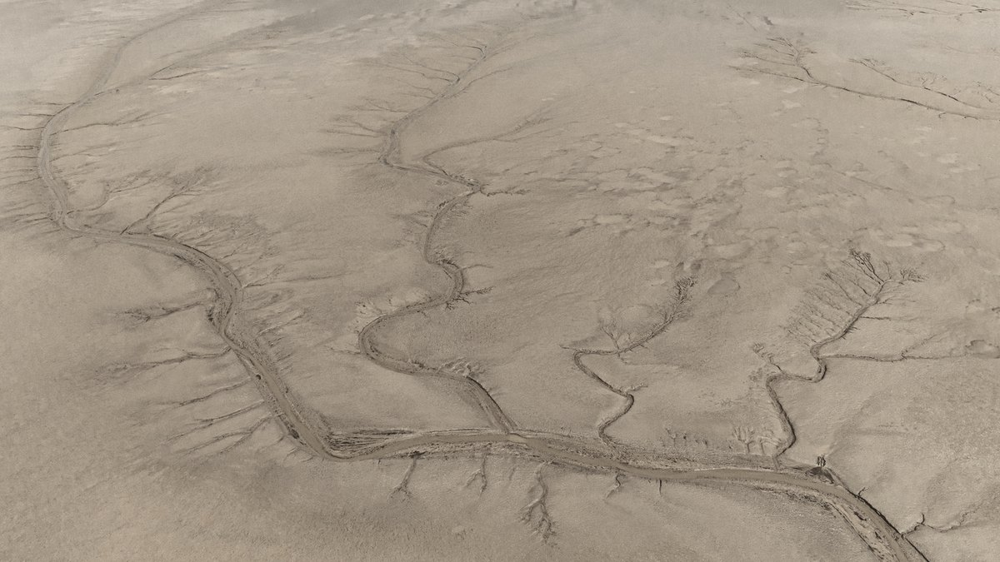

谨以此文献给那些在时间的褶皱里，替我们保管过一滴水、一声咳嗽、一截断裂的目光的人。

——题记

## 一

十七岁那年的雨季，我在祖父的遗物里发现了一册没有封面的笔记。

那是一个被雨水泡软的下午。老屋的瓦檐滴着水，滴答，滴答，像一只慢走的钟。父亲在堂屋里整理祖父的旧衣，我在阁楼上翻箱子。樟木箱一共三口，两口已经空了，第三口压在最底下，铜锁锈成一朵暗绿色的花。我用螺丝刀撬开，霉味扑上来，像一条沉睡多年的河突然翻了个身。箱底压着一件蓝布长衫，长衫下是一册线装笔记。没有封面，没有题签，纸页发黄发脆，边缘卷曲，像被无数次抚摸过的旧信。霉斑如褐色菊花开在宣纸上，翻开却是空白——不，不是空白。当我把它举到台灯下，纸页上浮现出密密麻麻的铅笔字，淡得像候鸟掠过天空留下的影。祖父用这种方式，藏起了一整条河流。

字太小，太淡。我把台灯拧到最亮，又拿来父亲的修表放大镜，鼻尖几乎贴上纸面，才认出第一行：“民国廿六年，端午。水涨了三尺，爹说龙王在翻身。”

这是我的曾祖父。

祖父一生寡言，像一棵把年轮长在身体里的树。他在我们县城中学做了四十年图书管理员，每天做的事就是修补旧书、登记借阅、擦拭书架。他回家后继续沉默，像一只关在玻璃瓶里的萤火虫，光都朝内照。我小时候最深的印象，是他坐在藤椅里看雨，一看就是一下午。我问他看什么，他说：“看河。”

可我们那里没有河。我们住在黄土高原的褶皱里，水比油贵。县城唯一的水源是一口深井，井绳磨得发亮，打上来的水带着铁锈味。我小时候洗澡，用的是脸盆。一盆水先洗脸、再洗脚、最后浇花。我问祖父：“河是什么样子？”他说：“河就是水在走路。”我又问：“水走到哪里去？”他沉默了很久，说：“走到记得它的人那里去。”

那时候我不懂。我以为他在说谜语。

那册笔记被放在樟木箱最底层，压在那件蓝布长衫下。长衫我认识，是祖父的，他每年只在除夕穿一次，然后仔细叠好，放进樟脑丸和笔记之间。仿佛那件衣服不是衣服，而是一层可以脱下的皮肤。我问父亲：“爷爷为什么只在除夕穿那件衣服？”父亲说：“不知道。他穿了就坐在院子里，也不放炮，也不看电视，坐到十二点，回屋睡觉。”我又问：“那件衣服是谁做的？”父亲摇头：“他没说。”

笔记很薄，大约只有三十页。我数了数，全部加起来约莫八千字。祖父用了六十年，写下八千字，平均每天写0.36个字。有些年份他只写一个标点——比如1959年，整整一年只有一个问号，那个问号写得极轻极淡，像一滴悬在叶尖、终究没有落下的露水。1966年是一个省略号，六个点，点与点之间隔得很开，像一排站在悬崖边的人。1976年是一条横线，平平的，长长的，像一条干涸的河床。1984年，他写：“今天下雨。屋顶漏了。我用脸盆接。水声很好听。”就这一句。1985年，他又写：“今天下雨。屋顶修好了。听不见水声。睡不着。”还是就这一句。

我决定把这册笔记抄下来。不是因为它珍贵，而是因为有一天，我发现那些字正在消失。光一照，它们就淡一分；手一碰，它们就退一寸。像退潮。我抄第一页时，铅笔字在我指腹下碎成粉末，像灰色的雪。我吓坏了，从此只敢用手机拍照，把照片放大，再逐字抄到新本子上。抄到第三页时，我看见了曾祖母的名字：阿棠。

## 二

阿棠，这是南方女子最常见的乳名。可我的曾祖母姓甚名谁，连我父亲都不知道。祖父从未提过他的母亲。仿佛他是一棵从石头缝里蹦出来的树，不需要根。

笔记里，阿棠第一次出现是在民国廿七年，腊月廿三。“今日小年，阿棠蒸了白糕，用井水冰着。她说，井水甜，能甜到心里去。我偷偷留了一块，藏在她枕头下。她夜里翻身，摸到了，没说话，只是笑。她笑的时候，河水就涨了一寸。”

我读到这里，忍不住笑了。祖父写“河水就涨了一寸”，可他身边根本没有河。他是在用想象，给祖母的笑找一个容器。没有河，就造一条河。没有水，就用记忆来蓄水。

再往后翻，阿棠在祖父笔下，是一连串水的意象。她是清晨河面上的雾——“阿棠早起淘米，雾从河面漫上来，把她裹住。我喊她，她应一声，声音从雾里钻出来，湿漉漉的。”她是石埠头捶衣时溅起的水花——“阿棠捶衣，棒槌一起一落，水花溅到我脸上。她说，男孩子不要看女人洗衣。我说，我看的是水。她说，水有什么好看。我说，水里有你。”她是梅雨天屋檐下断线的水珠——“雨下了七天。阿棠在檐下接水，一盆一盆，倒进缸里。她说，天赐的水，不能糟蹋。我说，天天下雨，烦死了。她说，等天旱了，你就想它了。”她是油灯将熄未熄时，玻璃罩上凝结的、最后那滴水汽——“阿棠吹灯，灯罩上有一层水汽。她用手指画了一个圈，圈里写了一个‘安’字。我问她写给谁。她说，写给水看的。”

“阿棠的手在水里泡久了，指腹起皱，像核桃壳。但她毫不在意。她说，水能记住一切。我说水记不住，水是世上最善忘的。她就把手从水里抽出来，指着我胸口说：‘这里记得。’”

祖父的文字像水。没有形容词，没有抒情，只有白描。可恰恰是这种极简，让每一个字都蓄满了力，像一滴水，看似柔软，却能穿石。我抄这些句子时，常常停下来，看窗外。我们县城没有河，但雨季时，雨水在土路上冲出一道道小沟，浑浊的水裹着黄土，流进低洼处，积成一个个小水坑。我小时候踩过那些水坑，溅一身泥，回家挨骂。祖父从不骂我。他只是拿一把扫帚，把院子里的积水扫开，扫出一条细细的水道，让水流到墙根的花圃里。他扫得很慢，很仔细，像在写一行字。

我现在才明白，他是在给他记忆里的河，修一条支流。

1948年，阿棠死了。我没有翻到详细记载。在1948年秋分那天，祖父只写了一行：“河干了，从此我没有母亲。”

十个字。此后整整三年，笔记里没有一个字。空白，彻底的空白。在1951年元旦，才重新开始：“今天教员说，要有新气象。我把书库理了一遍，发现一套《史记》，缺了《河渠书》一卷。”

《河渠书》。我查了，讲的是大禹治水，是河流与人的搏斗。那卷书，祖父一生没补上。他后来修补过无数本破书，用糨糊、宣纸、丝线，把散了架的《红楼梦》重新装订，把被老鼠咬缺的《聊斋志异》补全，唯独那套《史记》，永远缺着《河渠书》。我问他：“爷爷，为什么不把那卷补上？”他说：“补不上。有的东西，缺了就是缺了。”我当时以为他在说书。现在我知道，他在说自己。

## 三

我父亲是另一种沉默。祖父的沉默是深潭，父亲的沉默是暗流。他在县水利局做技术员，一辈子跟水打交道——打井、修渠、建水塔。他从不谈感情，像一台精密的仪器，只输出数据。我高考那年，母亲问他：“儿子报什么专业？”他头也不抬：“水利。”我说我想学中文，他沉默了很久，最后说：“水能载舟，也能覆舟。”

然后他去了工地。

但我记得一件事。我八岁那年，县城大旱，自来水停了四十天。父亲每天凌晨四点起床，骑自行车去十里外的机井取水，驮两桶回来，灌满家中所有容器。水桶是铁皮的，磕得坑坑洼洼，骑在土路上咣当咣当响。我那时贪睡，只记得迷迷糊糊中听见铁桶响，然后听见父亲在院子里倒水，水声哗啦哗啦，像一种安心的钟。第四十一天，下了场暴雨。父亲站在雨里，仰着头，张着嘴，一动不动，像一棵渴了太久的树。他站了整整一个小时，全身湿透，水从头发滴到下巴，再从下巴滴到地面。他哭没哭，我不知道，因为雨太大了。

那天夜里，祖父在笔记上写：“今天下雨。儿子站在雨里。他小时候，也是这样。他母亲死的那天，他在院子里站了一夜，没哭。雨把他泡软了，也没哭。今天他哭了。雨太大，看不见。但我知道。”

这是祖父第一次，也是唯一一次提到父亲。

我后来问父亲：“你记得那年大旱吗？你站在雨里。”父亲正在修一个漏水的水龙头，头也不抬：“不记得。”我说：“爷爷记了。”他手上的扳手停了一下，又继续拧：“他记他的。”我说：“他写你哭了。”父亲沉默了很久，把扳手放下，说：“雨太大。眼睛进水了。”然后他站起来，去院子里抽烟。他戒烟十年了，那天又抽了一根。我看见他站在院子里，仰头看天，天很蓝，没有雨。他站了一会儿，回屋，把烟掐灭，说：“你爷爷的笔记，别看了。都是些旧事。”我说：“我已经看了。”他说：“看了就看了。别跟你妈说。”我说：“为什么？”他说：“她不懂。她没在河边住过。”

我们家没有河。但父亲说“没在河边住过”，好像我们曾经住在河边。好像那条河，在我们家族的血液里，一直在流。

## 四

我考上大学，离开县城那天，父亲送我到车站。车晚点了，我们站在月台上，沉默像一堵墙。他突然说：“你爷爷的书里，有一张照片。”

“什么照片？”

“他母亲的照片。他不肯给我看。他说，一看，就没了。”

我没再问。车来了，我上车，他站在月台上，没有挥手。车开动时，我回头，看见他转过身，背对着我，肩膀微微耸动，像风吹过麦田。

大学四年，我读中文系，研究现当代文学。我读过无数关于河流的文本：沈从文的沅水，汪曾祺的高邮湖，苏童的香椿树街，莫言的胶河。但没有任何一条河，像我祖父笔记里那条无名的小河——那条河不在任何地图上，只在时间的深处，在记忆的最底层。沈从文的河里有船，有妓女，有水手，有吊脚楼；汪曾祺的河里有鸭蛋，有荸荠，有蒌蒿；我祖父的河里，只有一个女人。她淘米，捶衣，接雨，吹灯。她笑的时候，河水涨一寸；她死的时候，河水干了。

大三那年，我决定做一件疯狂的事。我要把祖父的笔记复原。那些褪色的铅笔字，我用显微镜拍照、放大、逐字辨认。缺失的部分，我去县志、档案馆、老照片里找线索。我甚至去了祖父年轻时教过书的乡村小学，那里的老人还记得，有个不爱说话的先生，每天傍晚坐在河边看水。

“他看水的时候，像在等人。”一个老人说，“又像在等水把他带走。”

那所小学在一条小河边。河不宽，水很浅，河底铺着鹅卵石，水草在水里摇，像谁在慢慢梳头。老人说，陈先生（我祖父）每天放学后，就坐在河边的石头上，也不看书，也不钓鱼，就坐着。有时候天黑了还不走，校长打着手电去喊他，他才站起来，拍拍裤子上的土，说：“水声好听。”校长说：“水声有什么好听？”他说：“像有人在说话。”校长问：“说什么？”他说：“听不清。听清了就不好了。”

我在那所小学的旧档案里，找到一张1965年的教师合影。祖父站在最后一排最右边，瘦，高，戴一副黑框眼镜，嘴角微微抿着，像在忍住一句话。照片背面有一行铅笔字，是祖父的笔迹：“河在照片外面。”

我拿着照片，站在那条小河边。河还在，水还在流。我蹲下来，把手伸进水里。水很凉，从指缝漏走，像时间。我忽然想起祖父笔记里的一句话：“阿棠说，水能记住一切。”我对着河水说：“阿棠，我是你曾孙。”水没有回答。但水声一直在响，哗啦，哗啦，像有人在很远的地方淘米。

## 五

2019年，我在一家旧书店找到一本民国日记。日记的主人是个小学教员，与祖父同龄。日记本封皮上写着“民国三十七年”，内页被虫蛀了好几个洞，但字迹尚可辨认。在1948年9月的一则里，我读到：“今日又见陈先生坐在河边。他从日出坐到日落，不动如石。有人问他在做什么，他说：‘她在水里。我要等她浮上来。’”

我浑身一震。

“她”是谁？是阿棠吗？

我继续查。在另一本地方文史资料里，我看到一则简短的记载：“1948年秋，连日暴雨，河水暴涨。一农妇为救落水幼童，被水卷走。三日后，尸身在下游五里处被发现。幼童得救。农妇姓林，名淑棠，年三十一。”

林淑棠。阿棠。

原来不是病死的。是溺死的。

资料里还有一行小字：“淑棠氏，本县林家坳人，嫁陈家村陈氏，生一子。性温厚，善织布，邻里称贤。殁后其子年十七，独力营葬，不哭，不食，三日不语。村人奇之。”

十七岁。祖父那年十七岁。他独力营葬，不哭，不食，三日不语。村人觉得奇怪。可我知道，他不是不哭，他是把眼泪存在了水里。他不是不语，他是把话写进了那册笔记。那册笔记的第一页，就是民国廿六年端午。他从十七岁开始写，写到七十七岁，写了六十年。

我再次翻开祖父的笔记。在1948年秋分那天，那行字后面，还有一行更淡的字，几乎不可见。我把照片放大五十倍，才看清：“阿棠，我替你活着。”

那一年，祖父十七岁。他母亲为了救一个别人的孩子，死在水里。他站在河边，等母亲浮上来。母亲没有浮上来。他就自己沉下去，沉进另一种水里——沉默的水，记忆的水，笔记的水。他用六十年，把自己变成一条河，把母亲藏在河底。

我打电话给父亲，告诉他这个发现。电话那头，沉默了很久。然后他说：“我知道。”

“你知道？”

“我十五岁那年，偷看过你爷爷的笔记。那时候字还没这么淡。我看到了。”

“你为什么不说？”

“说什么？说他母亲为了救别人死了？说他一辈子活在河边？说他每天看雨，是在看她？”

父亲的声音突然激动起来，那是我第一次，也是唯一一次听见他激动。

“你以为我不想知道？我从小就没有奶奶，你爷爷从不提她。我问他，他就说‘忘了’。可他不忘，他一天都没忘！他把她锁在书里，锁了一辈子！我恨他这一点，恨他把所有事都关起来，恨他把我也关在外面！”

电话断了。我坐在宿舍里，窗外是城市的万家灯火，没有一条河。但我听见了水声。从电话断掉的地方，从父亲沉默的地方，从祖父笔记的纸页里，水声漫上来，漫过我的脚踝，漫过我的膝盖，漫过我的胸口。我大口呼吸，像一条被抛上岸的鱼。然后我听见祖父的声音，很轻，很淡：“水能载舟，也能覆舟。但水不会淹死记得它的人。”

## 六

2020年，疫情暴发。我困在城里，回不去。父亲打电话来，问我在哪里过年。我说：“在宿舍。学校封了。”他说：“那你吃什么？”我说：“泡面。”他沉默了很久，说：“你妈包了饺子，我给你寄。”我说：“寄不了，快递停了。”他说：“那我给你送。”我说：“爸，你别来。路上危险。”他说：“我开车。不下车。到你楼下，你把东西拿走。”我说：“太远了，五百公里。”他说：“五百公里算什么。那年我驮水，一天骑四十里。”

他真来了。开了七个小时的车，后备箱里放着一保温桶饺子，还有一箱牛奶，一袋苹果，一包口罩。他把车停在我宿舍楼下，打电话让我下去。我下楼，他站在车边，戴着口罩，隔着两米远，把东西递给我。我说：“爸，你回去吧。”他说：“你吃一口，我看看。”我打开保温桶，吃了一个饺子。韭菜鸡蛋馅的，还是热的。他说：“好吃不？”我说：“好吃。”他说：“你妈包的。她说你爱吃韭菜。”我说：“我知道。”他说：“那我走了。”他上车，发动，又摇下车窗，说：“你爷爷的笔记，你还在看？”我说：“在看。”他说：“别看了。看了心里堵。”我说：“堵了才通。”他愣了一下，说：“你这话，像你爷爷。”然后他开车走了。

那天夜里，他打电话来，声音很轻：“儿子，我问你一句话。”

“你说。”

“你说，你爷爷为什么一辈子不跟我说他母亲的事？”

我想了很久，说：“因为水一开口，就流走了。他得把水蓄着。”

父亲沉默了很久，说：“蓄着干什么？”

“蓄着给我看。”

父亲没说话。但我听见他在呼吸，很重，很慢，像在搬一块很重的石头。

然后他开始说。他说他小时候，有一天问祖父：“曾祖母长什么样？”祖父没说话，从箱底翻出那件蓝布长衫，说：“这是她的。她给我做的。她说，水蓝色的布最经脏。”父亲说：“可这是男式的。”祖父说：“她做的，就是男式的。她说，我穿上好看。”

父亲说，那是祖父一生中唯一一次，提到阿棠。然后祖父把衣服叠好，放回箱底，说：“你去玩吧。”

“我当时特别恨他。恨他不肯多说一句。恨他把所有东西都锁起来。可现在……”父亲停顿了很久，“现在我懂了。他不是不想说，他是不能说。有些事，一说，水就干了。他得留着那些水，才能活。”

我说：“爸，你现在能说吗？”

他说：“我说了。你不是在听吗？”

## 七

2021年，祖父去世。我回家奔丧。父亲把祖父的遗物交给我：那册笔记，那件蓝布长衫，还有一把钥匙。钥匙很小，铜的，锈迹斑斑。

“他留给你的。”父亲说，“他说，你知道开哪。”

我带着钥匙回到老家。祖父住过的房间还在，藤椅还在，窗还在。窗外没有河，只有一片荒地。但荒地尽头，有一口井。我从未注意过的井，被杂草掩埋，像一只闭着的眼。我问父亲：“那口井什么时候有的？”父亲说：“你太爷爷挖的。后来不用了，填了一半，还剩个井口。”我说：“我怎么不知道？”父亲说：“你小时候，我们怕你掉进去，用石板盖住了。后来石板碎了，草长高了，就没人记得了。”

我拨开草，露出井沿。井沿上有一个小小的锁孔。我把钥匙插进去，转了半圈，“咔嗒”一声，井沿弹开，露出一个暗格。

暗格里，是一方砚台，一支毛笔，一锭墨。还有一张照片。

照片泛黄，边角卷曲。上面是一个女人，二十多岁，穿着蓝布衫，站在河边。她身后是一条河，河面宽阔，水光潋滟。她笑着，笑得像水光一样明亮。照片背面，是祖父的字：“阿棠，民国廿五年，春。那年河水最清。”

这是阿棠。这是我曾祖母。这是我从未见过、却在我血脉里奔流不息的人。她的眉毛很淡，眼睛不大，嘴角微微上翘，像含着一滴水。她站得很直，一只手扶着河边的柳树，另一只手垂在身侧，手指微微张开，像在接什么。我想起祖父写的：“阿棠的手在水里泡久了，指腹起皱，像核桃壳。”照片上的手，看不清指纹，但能看见指节微微凸起，像五个小小的河湾。

我拿着照片，站在井边。风从荒地尽头吹来，带着土腥味，像记忆的味道。我突然明白：祖父不是在看雨，他是在看水。他不是在等水，他是在等一个人。他用一生，替她活着。用沉默，替她说话。用一本笔记，替她建了一座水的纪念碑。

父亲走过来，站在我身后。他看了一眼照片，说：“这就是奶奶？”我说：“是。”他说：“跟我梦里的不一样。”我问：“你梦里她长什么样？”他说：“我梦见她坐在河边洗衣服，我喊她，她回头，脸是模糊的。只记得她手很白，在水里泡着，像两片玉。”我说：“照片上她的手不白。”父亲说：“那是晒的。她天天在河边，晒黑了。”我说：“你怎么知道？”父亲说：“你爷爷写的。他说，阿棠的手，冬天白，夏天黑。冬天不洗衣，手就白回来。夏天一洗衣，手就黑。”我说：“爷爷连这个都写。”父亲说：“他什么都写。就是不写自己。”

## 八

我回到城里，开始写这篇小说。我写得很慢，像祖父一样慢。有时一天只写几十个字，有时干脆不写，只是坐着，看窗外的雨。我租的房子在七楼，窗外没有河，只有高架桥。桥上车流不断，轰隆轰隆，像一条钢铁的河。我有时把窗户打开，让雨飘进来，雨落在桌上，落在稿纸上，落在那张照片的复印件上。阿棠还在笑，笑得像水光一样明亮。

父亲打电话来，问我在写什么。我说：“写一条河。”

他沉默了一会儿，说：“写完了给我看看。”

“好。”

“你爷爷那件蓝布衫，我收着呢。等你回来，给你。”

“好。”

“还有……”他顿了顿，“那口井，我填了。你爷爷说，水要留着。可我填了。我怕有人掉下去。”

我没说话。

“可我现在后悔了。”他说，“水留着，是念想。填了，就真的什么都没了。”

我说：“爸，井填了，暗格还在。暗格里的东西，我拿出来了。水填不住记忆。”

他说：“你说话越来越像你爷爷了。”

我说：“像他不好吗？”

他说：“好。也不好。好的是，他心里有条河。不好的是，河太深了，别人进不去。”

我说：“那你现在进去了吗？”

他说：“我站在岸边。看见水了。水很清。能看见底。”

我问他：“底上有什么？”

他说：“有你奶奶的手。在洗衣服。一下，一下。水从她指缝漏走。”

我说：“你哭了吗？”

他说：“哭了。没出声。你爷爷说的，雨太大，看不见。”

## 九

我写到这里，已经和祖父的笔记一样长。八千字，一条河的长度。

祖父用八千字，写了一条河的一生：她的诞生、她的涨落、她的干涸、她的地下潜流，以及最后，她的重现。

我写得比祖父快。因为我用的是电脑，可以删，可以改，可以复制粘贴。祖父用的是铅笔，写错了只能划掉，划掉的字还在纸上，像一条被堵住的支流。我有时想，如果祖父有电脑，他会写多少？也许还是那些。因为有些话，不是写不快，是不敢写快。快了，水就浑了。得慢慢写，让水沉淀，让字浮上来。

现在，这条河流到了我这里。我该怎么做？是填了她，还是让她继续流？

昨夜，我梦见一条河。河水清澈见底，水底铺满鹅卵石，每一块石头上都刻着一个字。我弯腰去拾，水就漾开，字就模糊。我听见一个声音说：“别捞。水一停，字就没了。”

我醒来，窗外正下着雨。我打开窗户，让雨飘进来。雨落在桌上，落在稿纸上，落在那张照片上。阿棠还在笑，笑得像水光一样明亮。我想起祖父笔记里的一句话：“水最柔软，也最坚硬。它能绕过石头，也能滴穿石头。它能载舟，也能覆舟。它能忘记，也能记住。全看它流进谁的心。”

我拿起笔，蘸了蘸雨，在稿纸空白处写下一行：

“河流的第三种岸，不在远方，在每一次回忆的涨潮里。”

然后我放下笔。雨还在下。我知道，这条河不会干。因为有人还在写，有人还在看，有人还在等。

而水，一直在流。从民国廿五年，流到今天。从我曾祖母的指尖，流过祖父的笔尖，流过父亲的泪，流进我的血管。它是时间，是记忆，是爱。它没有名字，却比任何河流都长。

它没有岸，却比任何河流都深。

## 十

2022年春天，我回了趟老家。父亲把那件蓝布衫给了我。我穿上，站在那口被填的井边。风很大，吹起衣角，像水波。父亲站在远处，看着我，没说话。但我知道，他的沉默里，多了一些什么。也许是水。也许是岸。

我问父亲：“井填了，暗格还在吗？”

父亲说：“在。我把井沿撬起来，暗格是水泥砌的，填井的土进不去。里面还是空的。”

我说：“我想把照片放回去。”

父亲看了我很久，说：“放回去，就又是秘密了。”

我说：“秘密不是坏事。秘密是水底的石子。水清了，石子就看得见。”

父亲说：“那你放吧。”

我把阿棠的照片装进一个塑料袋，扎紧，放进暗格。又把祖父的笔记复印了一份，也放进去。原件我留着，我要把它修好，重新装订，补一个封面。封面上写什么？我想了很久，最后决定写：“河流的第三种岸。”

我问父亲：“爷爷为什么把暗格藏在井里？”

父亲说：“你爷爷说，井是河的根。河干了，井还在。井干了，根还在。根在，水就还会来。”

我说：“那我们把井重新挖开吧。”

父亲说：“挖开干什么？没水了。”

我说：“不挖水。挖记忆。”

父亲沉默了很久，说：“你挖吧。我帮你。”

我们花了一个下午，把填井的土挖出来。土很硬，混着碎石和草根。挖到三尺深，土变湿了。挖到五尺深，渗出水来。父亲蹲下来，用手捧了一捧水，闻了闻，说：“是甜的。”我说：“井水甜，能甜到心里去。”父亲愣了一下，说：“你爷爷写的？”我说：“阿棠说的。”父亲把水喝了，说：“是甜的。”

那天晚上，父亲坐在院子里，穿着那件蓝布长衫。他穿着有点短，袖口吊在手腕上。他低头看了看，说：“你爷爷比我矮。”我说：“他瘦。”父亲说：“他瘦，但骨头硬。”我说：“你怎么知道？”他说：“他一个人，把你曾祖母藏在井里，藏了六十年。骨头不硬，藏不住。”

我说：“爸，你恨他吗？”

父亲想了想，说：“恨过。现在不恨了。恨也是水。流走了。”

然后他站起来，走到井边，把蓝布衫脱下来，叠好，放在井沿上。他说：“给你爷爷留着。他喜欢穿这件。”

我说：“你穿吧。他给你的。”

父亲摇头：“他没给我。他给你了。”

我说：“那你穿一次。就一次。”

父亲看了我一眼，把蓝布衫重新穿上。他站在井边，月光照在他身上，蓝布衫泛着水光。他忽然说：“你爷爷说的对。水蓝色的布，最经脏。”

我说：“也最经得住时间。”

父亲笑了。那是我第一次看见他笑。笑得很轻，像水面上的一圈涟漪。他说：“你爷爷要是听见你这话，肯定又在笔记上写一行。”

我问：“写什么？”

他说：“写：‘今天孙子说话了。像水声。’”

后记

写完之后，我回了趟老家。父亲把那件蓝布衫给了我。我穿上，站在那口被重新挖开的井边。风很大，吹起衣角，像水波。父亲站在远处，看着我，没说话。但我知道，他的沉默里，多了一些什么。也许是水。也许是岸。

2022年春，我在老家院子里种了一棵树。是柳树，水边生的那种。父亲问：“为什么种柳？”

我说：“柳，留也。”

他点点头，转身走了。走了几步，又回头，说：“你爷爷的笔记，借我看看。”

这是他第一次，主动要那册笔记。

我把笔记给他。他坐在藤椅里，一页一页翻。他翻得很慢，像在认字。翻到1948年秋分那页，他停住了。他看了很久，然后把笔记合上，放在膝盖上，仰头看天。天很蓝，没有雨。他的眼睛很干，没有泪。但他的手在抖，抖得像风中的柳叶。

我没有走过去。我站在院子里，看着柳树。柳树刚种下，枝条细得像手指。风一吹，枝条摇，像在招手。我想起祖父笔记里的最后一页。那是他去世前一个月写的，字迹已经颤颤巍巍：“今天下雨。阿棠来梦里。她说，水够了。别写了。我说，再写一行。她说，写什么。我说，写你。她笑了。水就涨了一寸。”

这是祖父留下的最后一行字。此后他没有再写。一个月后，他去世了。那天也下雨。父亲站在院子里，没有打伞。他站了一个小时，全身湿透。我站在他身后，没有喊他。我知道，他在等水。等水把他爷爷的话，带到他奶奶那里去。

现在，我也在等。等一条河，从记忆深处流出来，流过我的笔，流过我的字，流过每一个读到这篇小说的人。我不知道这条河有没有名字。也许它叫阿棠。也许它叫陈先生。也许它叫父亲。也许它叫儿子。也许它叫每一个在时间里沉默过、又在沉默里蓄过水的人。

河流的第三种岸，不在远方，在每一次回忆的涨潮里。
