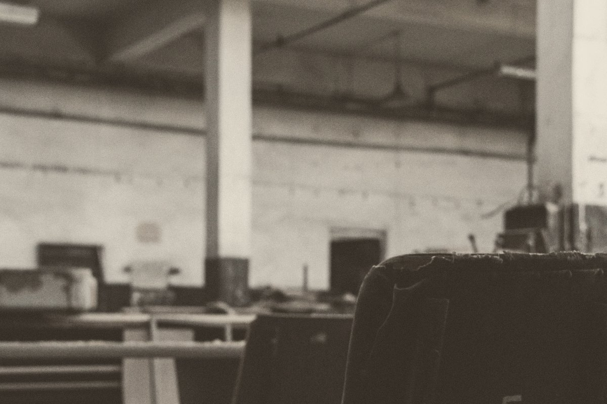

## 一

林越是宿舍里唯一一个把压缩饼干当早餐的人。

大一开学第一天，他拖着行李箱进门，箱子里三成是衣服，七成是物资。大米、纯净水、压缩饼干、一盒多功能刀具。三个舍友站在床铺边上，像看外星人一样看他从箱子里一样一样往外掏。

“兄弟，”周洋从上铺探出脑袋，“你是来上学的还是来逃难的？”

林越把压缩饼干码进衣柜最上层，码得整整齐齐，标签朝外。“有备无患。”他说了四个字，没多解释。

杨帆蹲在自己床上，怯怯地问：“这些东西贵吗？”

“不贵。比你一个月奶茶钱便宜。”

到了五月底，周洋床底下多了两箱泡面，孙嘉柜子里塞了一包五公斤压缩干粮，杨帆枕头边上搁了一把生存刀。林越没逼他们，就是隔三差五念叨几句。周洋起初当他神经病，后来被念烦了，顺手买箱泡面图清静。孙嘉做事认真，上网查攻略，把干粮换成了军用口粮，保质期二十年。杨帆纯粹跟风，买回来又舍不得用，藏在枕头底下当心理安慰。

晚上打游戏时周洋说：“林越，你说你这种人，是不是天天盼着世界末日？”

林越翻着《野外生存手册》，头也没抬：“不盼，但也不怕。”

“你这就是有病。”

“各活各的。”

## 二

征兆最先出现在食堂。豆腐脑窗口关了，说豆子供应不上。炸油条窗口也关了，说面粉涨价太厉害。一周后食堂贴通知，早餐时段缩短半小时。

没人当回事。食堂不好吃就点外卖，外卖慢了就去校外吃，校门口一排小馆子，总有好吃的。

但林越注意到的不止这些。校门口流浪狗少了，以前后街七八条，那条大黄最凶，最近一条都见不着。校医院感冒药断货，退烧药限购。他还在深夜刷到一条本地帖子，说市第三医院门诊爆满，急诊排到三百多号，底下有人回“别瞎传，就是流感”。帖子很快删了。

林越把这些事在脑子里拼在一起，打开电脑调出本市地图，把三院、火车站、长途汽车站、两个大型农贸市场标出来，用红笔在几个点之间画了几条线。

周洋从上铺探下脑袋：“你又在搞什么？”

“随便看看。”林越把地图最小化。

## 三

六月十二号下午，他去火车站取快递，顺便去市场买劳保手套。火车站前面停着三辆特警车，穿防护服的人背着喷雾器在公交站台上喷东西。一个白大褂在跟警察说话，嗓门很大：“已经三起了，同一个症状，高烧不退，意识模糊，有攻击倾向。”

警察压低声音问了句什么。白大褂摆手：“潜伏期太短，不到四十八小时。”

林越没往前走。他拐进市场买了手套，又买了五把刀、两卷登山绳、一盒净水片。回学校的路上给周洋发微信：“晚上别出去吃饭，我开个会。”周洋回了个问号。

晚上九点宿舍门关上，林越把地图摊开，指着红圈：“我接下来要说的事，你们可以当我是神经病，但听完再骂。”

他把食堂停供、流浪狗消失、药房断货、三院急诊爆满、火车站消毒串在一起讲了一遍，最后说：“一周之内，这个城市会出乱子。传染病，传染性强，潜伏期短，感染者有攻击性。说白了，丧尸。”

周洋愣了两秒：“你电影看多了吧。”

“我看的是医院和火车站。”林越把一沓假条拍在桌上，“我在校外租了公寓，物资搬了一部分过去。你们明天晚上之前跟我转移。”

孙嘉推了推眼镜：“辅导员那边……”

“假条写好了，外出租房，你们三个陪我。签字就行。”

周洋盯着他看了十秒钟：“你是不是早就准备好这一出了？”

“一直在准备。”林越说。

## 四

六月十三号晚上，四个人拖着行李箱从学校侧门溜了出去。

公寓在学校北门外三公里，老旧六层砖混楼，没电梯，声控灯得使劲跺脚才亮。六楼，两室一厅，不到七十平。客厅靠墙一排铁架子，码着生活物资。两个卧室摆了上下铺，一个睡人，一个当杂物间。厨房里两个五十升塑料储水桶灌满了水。天台上一台脚踏发电机。

周洋环顾一圈，吹了声口哨：“你他妈是退伍的吧？”

“我是农村出来的。小时候发洪水，断电断水七天。那时候要是有这间屋子，我爷爷不会死。”

没人再开玩笑了。

当晚林越把四个人分了工。周洋负责体力活，搬水、发电、修东西、加固门窗。孙嘉负责医疗和记录，药品清点、伤员处理、每天写日志。杨帆负责内勤，做饭、烧水、清点物资，守夜时负责听动静——他睡觉轻，有点声音就能醒。林越自己负责统筹和外出侦察。

“我要是出去了回不来，按顺序顶上。孙嘉顶我，杨帆顶孙嘉，周洋最后。顺序写在纸上，贴墙上。”

前三天风平浪静。第四天学校通知暂停线下教学，第五天全市中小学停课。第六天晚上周洋刷到一条视频，市中心商场门口一个男人在咬另一个人的胳膊。视频几分钟就被删了。

第七天凌晨两点，林越趴在窗户上往下看。路灯底下有个人在跑，跑得歪歪扭扭，后面跟着三个，跑得更歪，胳膊甩得幅度特别大，像关节忘了上油。

他把三个人都摇醒。

“来了。”

## 五

第一周最混乱。官方通报说是新型狂犬病变异，可控可防。但火车站封了，高速路口设了卡，超市门口排的队从街头排到街尾。楼下便利店老板往车上搬货，搬了一半开车跑了，店门都没关。

林越把门反锁，钢管横在门框上，门后摞了两袋大米。窗户全部拉上窗帘。四个人轮班守夜，每班两小时。

第四天晚上有人敲门，敲得很急很重，不是正常人的节奏。杨帆吓得钻到床底下。敲门声持续了三分钟，停了。过了几分钟隔壁传来撞门声，然后是玻璃碎掉的脆响，再然后是一个女人的尖叫。那声尖叫只响了一秒就断了。

周洋脸色铁青：“怎么办？”

“不怎么办。”林越把刀放下，“我们管不了。”

那天晚上没人再睡得着。杨帆在床底下蹲到天亮，出来时腿麻得走不了路。

## 六

第一个月过完的时候，杨帆开始发烧。

三十八度七，没有咳嗽，没有流鼻涕，就是高烧、浑身没劲、头晕。林越给他吃了退烧药，让他单独睡一个铺位，戴上口罩。第二天烧退了，杨帆说想吃泡面，周洋给他泡了一碗。当天晚上又烧起来，这次四十度，一直说胡话。

林越把杨帆捆在了床上。不是狠心，是杨帆烧糊涂了之后往窗户上爬。孙嘉帮忙按腿时手都在抖。林越把布条系紧，又拿毛巾给他擦身子物理降温。

烧了三天。第三天晚上杨帆忽然安静了，林越摸他额头，凉的，全是冷汗。他解开布条，杨帆睁开眼睛看了他一眼，说“我想喝可乐”，然后又闭上了。这次闭眼之后呼吸越来越浅，林越守到凌晨四点，杨帆胸口不动了。

四个人里最胆小的，走在了最前面。

杨帆死后第三天，林越在整理杂物间时发现褥子底下压着一块纱布，纱布上全是黑紫色血迹，上面有一道口子，边缘发黑。他又去翻杨帆的抽屉，最里面压着一张叠得方方正正的纸，是杨帆的字：

“林越，我对不起你们。前天晚上轮到我守夜，听见楼道里有动静，我趴在门缝上听，门链没挂好，被外面那东西扒开了一条缝，手伸进来抓了我一下。抓在小腿上，不深，我当时没觉得疼。我不敢跟你们说，怕你们把我赶出去。我自己拿酒精擦了，拿纱布包了。我想着兴许没事……”

后面没写完。纸上有几道很深的折痕，像是被反复打开又合上过很多次。

林越把纸折好揣进口袋，走到客厅把纱布和纸放在桌上。周洋和孙嘉对视一眼，都没说话。

孙嘉先开口：“他死了之后没变。”

三个人沉默了。杨帆的遗体裹着床单搁在杂物间三天，没有睁眼，没有抽搐，没有爬起来撞门。

林越说：“官方通报说的是‘新型狂犬病变异’。狂犬病有个特点，人死了，病毒也死了。尸体不会动。楼下那些东西是活人。被感染了，脑子坏了，但身体还活着。会走会动会咬人，等它们彻底死了，也就不动了。”

孙嘉推了推眼镜：“你确定？”

“我观察了快两个月。有倒在地上不动的，有还在晃的。不动的你踢它它也不动。动的你跑它就追。活的跟死的，差别在这儿。”林越指了指自己的脑袋，“病毒靠脑子活着，脑子死了，病毒也活不成。”

周洋说：“那要是我们被咬了，也一样？”

林越看了他一眼：“杨帆身子弱，我们不一定。”

那天晚上孙嘉在日记本上把杨帆的真正死因和这套推断记了下来，最后加了一行：“杨帆不敢说，是因为怕被丢下。我们让他觉得会被丢下，是我们的错。但他死了之后没变，至少证明这东西不是电影里那种死了还能爬起来的怪物。”

## 七

杨帆死后，剩下三个人重新分工。林越负责统筹和外出侦察，周洋负责体力活，孙嘉负责医疗和记录。

孙嘉每天写日记，用圆珠笔写在打印纸背面。记日期、气温、吃了什么、谁值了夜班、楼下又来了几波丧尸。写得工工整整。有时候末尾加一两句自己的话。有一天的末尾他写：“今天吃了粥，周洋说像洗碗水。我说洗碗水也比没得吃强。他说那倒是。我们笑了。这种时候还能笑，挺厉害的。”

第二个月中旬，公寓开始被围。楼下的丧尸越聚越多，最多的时候楼下十七个。它们不会开锁，但会撞门。一楼那户的门被撞开了，里面的动静持续大概五分钟，然后就安静了。

储水桶还剩一半。粮食还剩大米二十斤、挂面八把、压缩饼干两箱。林越开始定量：每天每人两把米煮粥，上午一顿下午一顿，压缩饼干掰碎泡在粥里。周洋瘦了十五斤，以前一百八的体重，现在像根竹竿。孙嘉颧骨顶着皮，眼镜框老往下滑。

有一天晚上周洋忽然说：“林越，你后悔吗？”

“后悔什么？”

“后悔把我们带出来。要是留在宿舍，说不定学校会管。”

林越掀开窗帘一角往下看了一眼：“学校管不了。新闻断之前那两天，大学城最先乱。宿舍楼一间挨一间，跑都跑不掉。”

周洋没再说话。

## 八

第三个月初，粮食见了底。大米不到三斤，挂面剩两把，压缩饼干只剩一箱半。按三个人每天两把米煮粥的量，撑不过十天。

林越在露台上蹲了三个晚上观察丧尸的活动规律。他发现每天凌晨四点到五点之间，楼下丧尸会少一半，往城东方向挪，过一两个小时又晃回来。这个空档大概有四十多分钟。

“我去趟便利店。”林越把三人叫到一起，“凌晨四点走，四十分钟够搬一趟东西。”

孙嘉推了推眼镜：“我跟你去。我不搬东西，我站巷口给你望风。你进去搬，我盯着外面，有情况敲铁皮桶。”

林越看了他一眼。孙嘉这几个月瘦了不少，但精神头还可以，做事仔细。望风这个活确实需要他干。

“行。周洋守家。我进去搬，孙嘉在巷口盯着，有动静敲桶，三长两短。”

凌晨三点五十，两个人摸黑下了楼。街上丧尸果然少，零星几个趴在路边，被灰埋了半截。两人猫着腰穿过去，没惊动它们。

便利店在街对面，中间隔着一条马路。林越蹲在路沿石后面观察了两分钟，对面巷口有三个丧尸在晃，离便利店门口五六米远，暂时没发现他们。

“我过去，你把着路口。看见它们往这边来就敲桶。”林越把铁皮桶递给孙嘉。

孙嘉点头，蹲在路沿石后面，铁管搁在手边。林越深吸一口气，快步穿过马路，闪进便利店。仓库里货不多，他摸到两箱矿泉水、一箱方便面，又摸到一袋卫生纸。分两趟往门口搬。

搬第二趟的时候他听见外面敲了一声桶。他立刻停下来，贴着卷帘门缝往外看。巷口那边，孙嘉蹲在路沿石后面，铁皮桶举在手里。他前面七八米远的地方，两个丧尸正从巷子里晃出来，方向正对着他。

林越看见孙嘉慢慢把铁皮桶放下，攥住铁管。他没跑。他往反方向挪了几步，把丧尸的注意力往自己那边引。

那两个丧尸发现了他，歪歪扭扭冲过来。孙嘉抡起铁管砸在第一个脑袋上，那东西倒了。第二个扑上来时他退了一步，鞋跟磕在路沿上，人往后一仰，铁管脱了手。第二个丧尸趴在他身上，他拿胳膊挡，没挡住。

林越冲出去的时候已经晚了。第二个丧尸咬在孙嘉左肩膀上，孙嘉一脚把它蹬开，从地上爬起来，撒腿就往回跑。跑了几步，巷子里又钻出来三个，他被堵在中间。

林越抡起撬棍冲过去，砸倒一个，一把拽住孙嘉的胳膊往回拖。孙嘉甩开他的手，吼了一声：“把东西搬回去！”

林越愣了一下。孙嘉肩膀上的血已经顺着胳膊往下淌了，左半边衣服洇透了，但他没往回跑，反推了林越一把：“我堵着，你搬东西，快！”

巷子里又冲出来两个。孙嘉弯腰把铁管捡起来，横在身前，堵在巷口。他背对着林越，肩膀上的血滴在地上，脚底下一小滩。

林越咬了咬牙，转身冲进便利店，把两箱水摞在一箱方便面上，用登山绳一捆，往肩上一扛。他冲出来的时候孙嘉还在巷口堵着，铁管抡得歪歪扭扭，但确实把几个丧尸堵在了巷子里。

“走！”林越扛着东西往楼道跑。

孙嘉跟在他后面跑了几步，又停下来，回头抡了一管子。他跑不快了，肩膀的伤在往外冒血，腿也发软。林越把东西搁在楼道口，回头要拉他，孙嘉喊一声：“别过来！”

他把铁管往地上一杵，靠着墙站住了，面朝着巷口那几个丧尸，头也没回：“林越，关门。”

林越站在楼道口，扛着东西，看着孙嘉的背影。孙嘉又说一遍：“关门。回去把门锁好，别管我。”

林越把东西拖进楼道，拉上铁门，从里面插门闩。他趴在门缝上往外看，孙嘉还靠着墙站着，铁管杵在地上，几个丧尸围上来时他抡了一下，没抡着，人往下滑。后面的事没看清，门缝里的灰太厚，他只能看见孙嘉的鞋，那双灰色运动鞋的鞋尖朝上，晃了一下，不动了。

林越把东西一趟一趟搬上六楼。周洋开门时看见他满身是灰、脸上全是汗，往他身后看一眼：“孙嘉呢？”

“他没回来。”

“什么意思？”

“他堵巷口，让我搬东西回来。”

周洋转身就往门口走。林越拉住他胳膊：“别去。我看着他倒的。”

周洋站住了。他站在客厅中间，两只手垂着，站了很久。然后他蹲下去，把林越搬回来的那箱方便面拆开，拿出一包，撕开调料包，干啃。嚼了两口，眼泪掉在面饼上，他拿袖口蹭了一下，接着啃。

林越坐在墙角，把孙嘉的日记本翻出来。翻到最后一页，看见孙嘉临走之前写的一段话：

“今天可能要出去找东西。林越说凌晨四点丧尸少，我跟他去望风。要是出事，日记本留给林越。万一将来有人看见，知道这栋楼里住过四个人：杨帆、周洋、林越、我，孙嘉。这辈子干得最对的事就是跟他们搬出来。这半年值了。”

林越把本子合上，放回原处。

## 九

第四个月和第五个月，日子过得像一锅熬干了的粥，黏在锅底，刮都刮不下来。

周洋咳嗽是第五个月初的事。一开始是干咳，后来咳出来带血丝。林越把剩下的药全翻出来，全喂了一遍。没用。周洋窝在被子里，声音嘶哑：“不是那个病。就是肺炎。搁以前去医院就好。现在……”

他没说完。林越知道他想说什么。没有医院，没有医生。那些药吃跟没吃一样。长期营养不良，免疫力垮了，什么病都能要命。

周洋撑了十二天。最后三天他已经起不来了，喝水都费劲。林越把他挪到靠窗的床上，让他能看看外面。周洋最后说的话是：“林越。”

“嗯。”

“孙嘉那本子，你收好了。别丢了。”

“收好了。”

“还有，你当初买泡面的时候，是不是应该多买两箱。”

林越笑了一下：“是。买少了。”

“下回……”周洋喘了两口气，“下回多买点。”

“好。”

周洋没再说话。

## 十

林越把遗体都搬到了杂物间，码放整齐，每个人身上盖一条从宿舍带出来的床单。杨帆盖格子纹的，周洋盖那条他嫌弃了一百遍的灰毯子。盖完后林越从周洋遗物里找出那半包没抽完的烟，在杂物间门口点着，放地上看着它烧完。

整间公寓只剩他一个人了。

他把物资重新清点了一遍：大米六斤，挂面三把，压缩饼干八包，矿泉水十四瓶。按他一个人的消耗量，省着吃能撑四十天。

他每天仍按时起床、烧水、泡一碗粥、分两顿吃。他把孙嘉的日记从头翻一遍，又找支笔，在最后一页背面开始写自己的记录。写日期、天气、吃了什么、楼下丧尸的数量、窗户缝里看见的一只野猫。

第六个月初，楼下丧尸的数量突然少了。林越观察了三天，发现它们不再漫无目的地晃荡，而是往城东方向走。他不知道城东有什么，也许什么都没有，也许有更大的尸群在汇合。他没深究。

他开始每天上天台坐一会儿，坐在折叠椅上看着这座城市的轮廓。高楼还在，玻璃幕墙碎了，像一排缺了牙的嘴。烟囱还在，不冒烟了。马路还在，上面走的东西已经不是人了。

有时候太阳好，他把孙嘉的日记本摊在膝盖上翻。翻到某一页他停住了，孙嘉在那页上抄了一段话：“世界上只有一种真正的英雄主义，就是在认清生活的真相后依然热爱生活。”

林越盯着看了很久，从口袋里掏出圆珠笔，在下面写了一行：“抄这句话的人已经不在了。说这句话的人也不在了。但这句话还在。”

他把本子合上，揣回怀里。

## 十一

最后那几天，林越做了几件事。

他把所有能吃的东西集中在一起，分成二十份，每天吃一份。水还剩十四瓶，一天一瓶，刚好两周。他把刀磨完搁在枕头底下。所有窗户检查一遍，该锁的锁，该钉的钉。杂物间的门用胶带从外面封死。

第七天早上他吃完当天的份额，喝了半瓶水。他把孙嘉的日记本、自己的记录本、还有那张四个人的合影装进防水袋，塞在天台花盆的土里，上面压了块砖。

然后他洗把脸，用湿毛巾擦一遍身子，换上最干净的一套衣服，大一开学时穿的灰色T恤，洗了太多遍领口都塌了，但没破。他套上外套，拉好拉链，穿上运动鞋，把鞋带系紧。

他拎着求生刀上了天台。

天气不错，六月份，天很蓝，云很高。远处能看见大学城的方向，宿舍楼的轮廓还在，窗户黑洞洞的像死鱼的眼睛。楼下街道上还有丧尸在晃，比上个月少多了，零零星星几个。

他在折叠椅上坐下来，把刀搁在腿上，面朝东边。那是日出的方向。

他想，等天黑之前它们会闻到味道找上来。六楼，它们爬不上来，但会围在楼下。等到晚上他睡着，也许会有哪个从楼道摸上来。门锁着，但它们会撞。撞开撞不开，无所谓了。

他靠上椅背闭起眼睛听风。风从楼宇间穿过来，带着一股说不清的味道，腐烂的、干燥的、混着灰尘的。他想起大一开学那天拖着行李箱走进宿舍，周洋从上铺探出脑袋问“你是来上学的还是来逃难的”。他想，周洋那会儿真傻，现在自己也真傻。求生求半年，最后也没活下来。

但他不后悔。这半年他吃自己囤的粮，喝自己存的水，没求过谁，没等过谁。他做到他能做的一切。

太阳升到正空的时候他站起来走到天台边上往下看了一眼。楼下聚了四五个丧尸，仰着头冲他张嘴，发不出声音，就那么张着嘴。

他把身体探出栏杆，深吸了一口气。

“我叫林越，”他对着空荡荡的城市喊了一句，“双木林，超越的越。我在这栋楼里活了半年。我带了三个兄弟出来，三个都走了。我是最后一个！”

声音在楼宇之间撞几个来回，传出去老远。

然后他回到椅子上坐下来，把刀攥在手里，闭上眼睛。

太阳很暖和。他想睡一会儿。

## 十二

林越是被光晃醒的。

他不知道什么时候在椅子上睡着的，求生刀还攥在手里，攥出了一手汗。天边的颜色不对劲，不是朝霞粉，也不是夕阳橘，是一种从没见过的白，惨白，刺眼，像有人把太阳掰碎了扔在地平线上。

然后他看见。

一朵蘑菇云从城东方向升起。那个位置他太熟悉，是化工园区那片。现在高烟囱没了，取而代之的是一个往上翻卷的巨大花冠，灰白色，胖嘟嘟的，像一朵长得太快来不及收的棉花。紧接着第二朵，更远一点，在南边。

林越坐在椅子上看着两朵云在两个方向同时长起来。他脑子里第一个念头是：核弹。第二个念头是：终于。

他等这一天等了很久。他早就过了害怕的阶段，剩下的是某种奇怪的平静，像考试交卷前最后五分钟，不会做的题反正做不出来，干脆放下笔等铃响。

核弹就是铃响。

冲击波来得比他预想的慢。大概过了十几分钟，一阵风刮过来，把天台上的空桶吹倒了，咣当咣当滚了两圈。然后是一声闷响，闷得不像爆炸，倒像有人在远处的地底下敲了一面巨大的鼓。

他站起来，把求生刀别在腰上，活动了两下胳膊腿。他发现自己居然在笑。嘴角往上翘，压都压不下去。他想，周洋要是还在，肯定得骂他神经病，看见核弹还笑。

“周洋，”他对着空气说了一句，“你说得对。我就是有病。”

他站在天台边上，看着蘑菇云往天上爬。风从东边灌过来，裹着灰，裹着热，裹着一股呛人的焦味。他的T恤被吹得贴在身上，猎猎作响。

他回到屋里，把门关好，把所有窗户又检查了一遍。他走到杂物间门口，隔着封门的胶带说了一句：“杨帆，孙嘉，周洋，你们先走一步。我随后就来。”

他把求生刀搁在天台的折叠椅上，坐下来，面朝东边。蘑菇云还在往上爬，灰白色的花冠已经散开了，变成一层灰蒙蒙的盖子扣在城市上空。远处的天是暗红色的，像烧过头的铁板。

他从口袋里摸出孙嘉的日记本，翻到最后一面。圆珠笔还在，他想了想，写了一行字：“核弹来了。没跑，也跑不掉。坐这儿等。不亏。”

写完他把本子合上，揣回怀里。又从另一个口袋摸出那张四个人的合影，看了一眼。周洋咧着嘴笑，杨帆缩着肩膀，孙嘉推着眼镜一脸正经，他自己站在中间表情有点呆。

风越来越大，灰越来越厚。他开始咳嗽，嗓子眼发干，嘴里一股铁锈味。他知道那是辐射尘。他坐着没动。

太阳被灰遮住了，天暗下来，像黄昏。林越靠在椅背上，闭上眼睛。他想，爷爷当年在洪水里等救援，等了七天。他现在等核弹，等了半年。爷孙俩差不多。

过了大概一个钟头，他开始觉得恶心。头也疼，浑身没劲。他摸了下自己的头发，一抓掉一把。他把手里的头发扔掉，在裤子上蹭手。

他睁开眼睛，看着灰蒙蒙的天。蘑菇云的盖子已经散得差不多，天边露出一条缝，透出一点光，是暗黄色的。他想，明天大概没有太阳。

他又闭上眼睛。这回没再睁开。

林越死在天台上。死的时候坐在折叠椅上，求生刀搁在腿上，怀里揣着孙嘉的日记本和四个人的合影。脸上的表情不算痛苦，嘴角微微往上翘着，像在笑，又像只是肌肉松弛。风把他的灰T恤吹得鼓起来，又瘪下去，鼓起来，又瘪下去。

## 十三

核爆后第三周，防空洞的水泥盖板从里面顶开了。

王桂芬探出脑袋，外面全是灰，白茫茫一片，像雪。她拽着孙子小浩爬出来，整栋楼空了，一楼几家住户的门都敞着。

他们从一楼往上走，走到六楼，门从里面反锁着。王桂芬拿撬棍别了两下，门框松了，一推就开。客厅里一排铁架子，码着粮食、水、药、蜡烛，收拾得整整齐齐。杂物间的门从外面用胶带封死了，打不开。

通往天台的门虚掩着。推开门，折叠椅上坐着一个人，灰T恤，牛仔裤，头歪向一边，闭着眼，嘴角微微往上翘。求生刀搁在腿上。风把人吹得晃了一下，又晃了一下。

王桂芬蹲下去，从那人怀里抽出一个本子、一张照片。本子最后一面上歪歪扭扭写着：“核弹来了，没跑。也跑不掉。坐这儿等。不亏。”

小浩说：“奶奶，咱们把他抬进去吧。”

王桂芬摇头：“他坐这儿等的。就让他坐这儿吧。”

她拉着小浩下了楼，回到防空洞。当晚小浩翻那个本子，从头翻到尾。他讲给王桂芬听：杨帆想喝可乐，孙嘉被咬之后堵巷口给林越断后，周洋最后说“下回多买点泡面”，林越在楼里活了半年，三个兄弟都走了，最后一个人坐在天台上等核弹。

小浩翻到最后一页，问：“奶奶，不亏是什么意思？”

“就是，他觉得这半年没白活。”

小浩想了一会儿，说：“奶奶，咱们往南走吧。林越哥没走成。咱们替他走。”

王桂芬想了一晚上。第二天早上她把东西清点了一遍，能带走的装了两个蛇皮袋，装不走的在墙上留了张纸条，写清楚东西在哪儿、有多少。纸条贴在防空洞入口，拿石头压住。

“走吧。”

走了四天。第一天路过一个加油站，翻出半箱矿泉水。第二天路过一个村子，人没见着，灶台上找到一罐猪油、半袋盐。第三天起风，灰扬得满天都是，拿湿毛巾捂着脸走。第四天小浩开始咳，王桂芬也咳。

第五天早上，小浩走不动了。坐在路边石头上，脸涨得通红，额头烫手。王桂芬知道这是什么，辐射病。

“奶奶，我渴。”

王桂芬把最后半瓶水喂他喝。小浩说：“奶奶，你说南边有活人吗？”

“肯定有。”

“那咱们快走。”

他站起来走了两步，又蹲下了。王桂芬把他扶到路边一棵枯树底下坐着，拿湿毛巾给他擦脸。小浩靠在她肩膀上：“奶奶，林越哥他们是不是也这样死的。”

“嗯。”

“那他们最后害怕吗？”

“怕到后来就不怕了。”

“我也不怕。就是有点困。”

“困了就睡会儿。奶奶看着你。”

小浩闭上眼睛。王桂芬搂着他，感觉温度一点一点退下去。退到最后，凉了。她把小浩放在枯树底下，拿一件干净衣服盖上脸，在旁边坐了一下午。

太阳快落山的时候她站起来，把东西归置归置，能带走的背上，带不走的放小浩脚边。

“奶奶往南走。替你看看有没有活人。”

她一个人接着走。灰还在扬，风还在吹，太阳在她背后，影子拖在地上老长。她踩着那道影子，一步一步，没停。

走了十天。路上没遇见活人，遇见过几拨丧尸，大部分被冲击波掀翻了，剩下的趴在路边像烂布。

第十一天，走到一个山脚下。半山腰有个水泥门洞，门口堆着沙袋，沙袋后面有人拿枪指着她。

“站住。干什么的？”

“活人。找部队的。”

沙袋搬开一条缝。里面是个山洞，几十号人，有穿军装的，有老百姓。有人端了碗热水，让她坐下。一个年轻军人蹲在她面前问市里的情况。王桂芬把核爆之后的事说了一遍，掏出日记本和照片递过去：“楼里还有遗体。本子上都写着。”

年轻军人翻了翻，看完之后合上本子还给她：“留着吧。是个念想。”

王桂芬问：“南边还有人吗？”

“有。往南还有个安置点。”

“那还行。没白来。”

第二天早上她又往南走。年轻军人给她塞了十瓶水、五包压缩饼干、一张手绘地图。

“老太太，你一个人行吗？”

“我走了十一天了，不差这几天。”

出了山洞，太阳刚升起来，灰少多了，天边透出点蓝。她沿着山路走，路边枯草丛里有一棵小树冒了新芽，嫩绿嫩绿的。她停下来摸了摸叶子，是软的。

她笑了一下，继续走。
