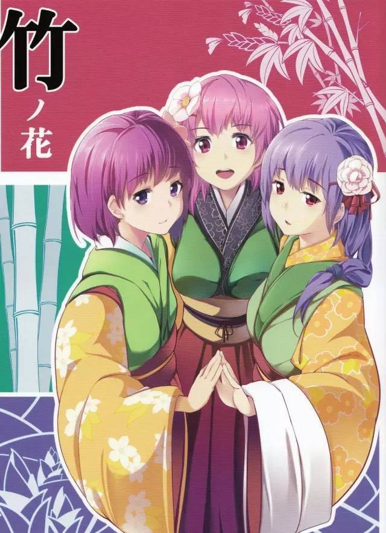
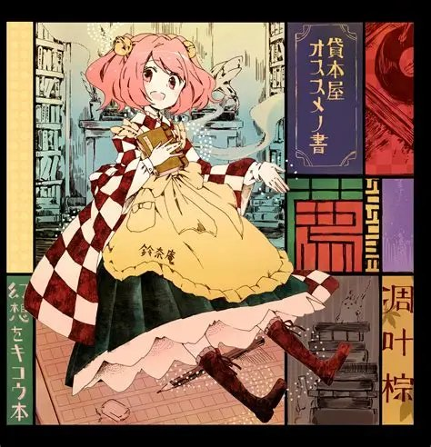

一个炎热的夏季，竹子悄然绽开花朵。

“咔！”寂静的竹林里突兀地传来砍竹子的声音。

“喂，大叔。为什么非得把这些竹子全砍了啊？”一个头顶斗笠的青年一手拿毛巾擦汗，一手拿水壶准备喝水，他接着问旁边的中年男人：“好不容易才长这么高。”

青年颇为惋惜，但中年男人却说：“你第一次看到竹子开花吧？竹子开花，不吉利啊。”

“不吉利？”戴斗笠的青年颇为不解。

“如果过了很多年才开花，倒也无所谓，索性就让它们这样枯死算了，”大叔顿了顿，又想起了什么：“对了，还有，我知道你跟东家关系很不错，可也要掂掂自己分量，不然只有互相伤害的份。”大叔抽了口烟，从鼻孔中吐出烟雾，说出意味深长的话。

## 稗田阿七 · 盛开之夏

竹林旁，有一座房子。

居室里，有一位女子。

她头上戴着花，紫罗兰色的头发遮住右眼，仅是不经意的一瞥，就足以让世间的男子陷入爱河。

此刻，她右手托住下巴，左手持笔在卷轴上写着什么。

“开了花，就只有死路一条，稗田家的女人，也是如此。一旦动情，生命便无法逆转地凋零。”

稗田家是镇子里的名门望族，据说他们家世世代代记录着幻想乡的历史。

青年是稗田家的佃户，此时正在稗田家的院子里询问东家的行踪。

“看到东家了吗？”青年拨开院子里晾晒的被单，向稗田家的佣人询问道。

“没啊，东家又不知道跑哪儿去了，你去找找吧。”稗田家的佣人对青年说。

青年哦了一声便转身离开了。

应该是去那里了，那个地方，除了我和她之外没有人知道。这样想着，青年已经走到那棵树下。

“喂，大伙儿都找你呐！”青年向着树上大喊。

树枝突然被扒开，露出了一个年轻的女子。

“被你找到了呀，真是的。”女子微笑着说：“能不能在下面帮我看着点？我这就下去，别担心，这点高度不算什么。”

青年望着树上的女子，内心无语地抱怨：我倒是好奇你是怎么上去的。

“只有这个地方，足不出院，就能把院子里的美色尽收眼底，看着大家辛勤地劳作，风吹着也很舒服。”女子自顾自地说着。

“我把鞋踢下去了哦？”女子突然对树下的青年说。

“什么？”青年连惊诧的工夫都没有，两只鞋子就从树上掉了下来。

“慢着，慢着！”青年慌了神，完全不知道怎么办才好。

“我也要跳了，好好接住哦？”女子俏皮地对青年说。

女子话刚说完，直接从树上跳下来，正好跳进青年的怀里。

“呵呵呵，你刚才是不是摸我屁股了？”

“才没有！”青年脸红地否认。

青年和女子一起坐在树下，两人沉默半晌，最终女子先开口打破沉默：“恐怕……以后再想爬这棵树就爬不动了。”

“为什么？”青年惊诧地扭过头去问身旁的女子。

“这副身体……已经不行了。”

青年慌了神：“别说这么不吉利的话呀！”

“我不是那个意思……我呢，其实并不怕死。”女人顿了顿，接着说：“我，只是为了记录幻想乡的历史，才出生在这世上，就算死了，记忆也会原封不动地传承下去，对我来说，转生不过是丢掉老去的身体而已。”

“我虽然不懂转生什么的，可你现在不是活得好好的吗？那就……继续这样活下去呗。”

女子看着男人，愣了一下，随后笑道：“是啊。”

青年起身拍拍身上的灰，对女子说：“时间不早了，我送你回去吧。”

“我要你背我！”

“好好好。”青年熟练地背上女子，向镇子上走去。

“那个……真该对你说……很多声谢谢呢。”趴在青年背上的女子闭上眼，还是阻止不了泪水从眼角滑落。

很多天以后青年受邀参加一场婚礼。

新娘是那位女子，她身穿白无垢，白色的角隐帽子在她头上增光添彩，今天的她，格外美丽。

新郎却不是青年。

也许……这就是她最好的结局吧

青年的生活很快回到正轨。女子，也有了身孕。

“呜呕呕呕……呜呕……呜……”

“哈啊……又吐了，呼……”

孕吐完的女子又突然想起青年。想起那天两人在竹林里观赏夹竹桃，青年用食指挠挠脸颊，羞涩地对女子说：“总有一天，我要攒好多好多钱，然后盖一座大房子，再娶你当我的媳妇儿！”

想到这里，女子以手捂面，泣不成声：“我这到底，是在干什么啊……”

“佣人呢？我想出去转转。”

在佣人的陪同下，女子来到田边。

“请您小心一点，东家！”佣人扶着女子，生怕出问题。

不远处出现了佃户劳作完回家的队伍。

“今儿也喝两盅吧。”

“成啊，还是老地方？”

“小子你也去吧？”

“我就免了，还没满二十呢。”青年扛着锄头，拒绝了邀请。

佃户们正走着，青年和女子四目相对了。

青年先是一愣，随即低下头，快步走开。

“请留步！这不是你想象的那样！”女子不顾肚子里的孩子，想要追上青年。

“求求你了，请听我说，请等一下！等我转生，我绝对会，绝对……”

青年转身，对女人说：“算了，不用了，就这么着吧。”青年勉强地笑着：“你也算是找到了门当户对的幸福嘛，哎呀，多少让我有点羡慕。”

青年戴上斗笠，压低了笠缘，快速离开。

对她来说，这也许是最好的结局吧，我这样说给自己听，可是，心里却留下一道细小而又刻骨的伤痕。这道既不会痊愈，也不会消失的伤痕，时时让我心痛不已。

而她，也在出产的那天撒手人寰，只留下一个腹中的孩子。

东家下葬那天，天空阴沉沉的，没有一丝光彩。出殡的人们也很沉默，就这么一路把棺材抬进墓室。“稗田阿七之墓”。人群中的青年看着墓碑上刻的字，良久，才转身离开。

## 稗田阿弥 · 凋零之秋

很多年后，青年长大变成男人，在那个秋天带着一群小子去修缮东家的房子。

“臭小子们，小心着点！”男人对瓦房房顶的小子们喊道。

“这就完事儿了老大！您请好吧！”小子们嘻嘻哈哈地回应男人，继续干着手中的活。

“哦，完事儿了赶紧回去吧，今儿晚上冷得很！”

男人抬头一望，便望到那棵树，树还是那棵树，只是……缘是秋天，不再繁茂了。

男人感慨起来，一晃就是十几年，不禁让人想起物是人非的一段岁月啊，我也变成……胡子拉碴的大叔了……

“老大你不回去？”小子们的话将男人从神游中拉了回来。

“哦，把这袋烟抽完就回去。”男人应着，手中的烟斗缓缓吐出烟雾。

“逮到你咯！”

被突然地从后背抱住，这熟悉的感觉，又是她呀。

“老大也够苦的！还得给东家看孩子嘛。”臭小子们打趣着。

“混账——赶紧滚蛋！”男人佯装恼怒，把小子们骂走了。

“呐呐呐，跟你说话呢，人家已经是大人啦。”

“是是……”男子露出无奈的表情，没法对她发火的。

“结婚了没？要不干脆娶我得了？”女孩托住下巴，一脸期待地看着男人。

男人不语，只是一个劲的抽烟。

“讨厌，听人家说话嘛！”女孩一把夺过男人的烟斗，烟斗的头儿上还沾着男人的口水。

“还给我啊。”男人无奈的说。

“不要！不给你！”女孩手拿烟斗兴奋地跑开。

“抓到我就还给你！来呀来呀！”

“这熊孩子……”男人又气又恼，女孩回头又冲男人扮鬼脸。

这女孩，就是如今的东家，稗田阿弥，也是阿七的遗腹子。

男人快步追上女孩，用双手撑开女孩的嘴巴，越撑越大。

“呜哇啊啊啊，好痛，快住手！还给你啦！”女孩吃痛的叫道。

“啊——累死我了，讨厌，对女孩子手还这么重。”男人和女孩累的躺在地上，女孩揉着自己的脸抱怨：“脸都被你拽歪了，人家要是嫁不出去可怎么办！”

“不过啊，能再次遇到你，真是太好了。”女孩歪着头，笑着看男人。

“别再开这种玩笑了。”男人闭上眼，类似的话已经听很多遍了。

女孩举起手，阳光透过大树繁茂的树叶穿过手指头的间隙照射在女孩的脸上，女孩说：“我没开玩笑，上辈子开始，就喜欢上你了嘛。”

“别瞎说，过来眯瞪会儿吧。”男人眯上眼睛，悠哉游哉地享受秋日午后的阳光。。

女孩却突然靠近男人，几乎是趴在男人的身上。

感受到一股热流，男人睁眼就看见女孩的脸。

“喂……你要干嘛！”男人语无伦次。

女孩也站起来说：“果然认不出来了吧？我的长相，你瞧瞧，这幅身体，又轻便又精神。这都是为了再次和你相遇啊。”

女孩俯视着男人，一脸的温柔，黑色的头发在阳光的照射下更显亮丽。

“今天的我呀，就是为了见到你，才出生在这世上的。”

入夜，居室内的女孩挑起灯，拖着下巴看手上的卷轴，良久，笑了。

“山芋？你每天就吃这个？”

虽说女孩做好了准备，可没想到男人的生活竟是这样的。

“怎么啦？烤熟了也能吃啊，很好吃的。”男人拨弄着手上的烤山芋。

“我不是说这个，我是说你啊。”女孩顿了顿“话说回来，你说过要买好大一片地，还要娶我当老婆的说。”

“很快……我会想办法的……”男人尴尬的将眼光瞟向别处，脸上的汗顺着脸颊滴在地上，发出滴答的声音。

“逗你玩呢，只要和你在一起，什么样的日子都能过。”女孩幸福地看着男人。

“那成，把这烤山芋吃了，全当预祝新生活了，小心烫。”男人把剥好的山芋递给女孩。

“哦哦！那我不客气啦！”女孩接过山芋大口啃起来。

男人啃着山芋问：“好吃吗？”

“很甜！”女孩双手捧着山芋看着男人，她看见男人脸上粘上了山芋，说“粘脸上了哦。”

女孩说着便贴上男人的脸，仔细地舔掉男人脸上的山芋。

“啊，住手！“男人显得十分尴尬，没预想女孩会直接贴上来：“喂喂，大伙都看着呢。”

远处的小子们远远地观望着女孩和男人，看到这一幕纷纷开始起哄。

“老大，真亲热啊！”

“快喝你喜酒了啊！”

“没想到，和东家走在一起了呢。”

“不愧是老大！”

人们起哄着，男人害羞地笑了。

像这样一瞬间，就变得这么幸福，一点实感都没有。

半年后，镇子上罕见地下起大雨。

“雨太大把河堤冲垮了！”

“镇上的男丁都得去救灾！”

去察看情况的人顶着大雨冲回镇上。

男人心情低落的说：“恐怕，一去就是几个月。”

女孩抚摸着男人的脸颊：“你不去，不行吗？”

男人摸着女孩的脸，无奈道:“我是兵头将尾，没办法啊。”

准备出发的人们坐在车上寒暄着：“行李都带够了？那走吧。”

“跟老婆孩子打好招呼了？”

“又不是上战场。”

天依旧下着大雨，简便的土路更是泥泞不堪。

正当车夫挥鞭准备驱车的时候，远处传来女孩的声音。

“等一下！请等一下！”

“喂，停一下车！”男人急了。

男人跳下车看着被淋湿的女孩说：“这么大的雨，怎么你还跑这么老远……你的鞋呢？”

“药！把这药带上！”女孩自顾自地说：“还有，还有啊…… ”

“慢慢说。”

“要好好吃饭，别喝不干净的水，天冷记得加衣服，别喝酒，不许见异思迁！还有，早点回来。”女孩一口气说完，脸上淌下的，不知是泪水还是雨水。

“嗯。”男人看着女孩，郑重的点头。

“啊……走了。”目送着男人离开，女孩开始找鞋子。

“怎么办……鞋子，找不到了，身体好沉……”

女孩每一步，都艰难地失去重心一般。

鼻子上有烫烫的东西。

女孩伸手一摸，手上全是令人绝望的红色，混着天上下的雨，在地上淌出一整片鲜红的血迹。

“啊咧，阿七，我该怎么办才好，怎么办啊，我只是，我只是爱着他而已啊！”女孩泣不成声，血与泪一齐流了下来。

“我只是想和他一起活着，一起变成老爷爷老奶奶而已，想陪在他身边而已啊！”

数月后

原先该有两人的居室，如今空无一人，屋外花盆里的花也枯萎、凋零。

男人在屋外坐着，手上拿着烟斗，良久，直到烟斗中的烟也熄灭了。

佣人们则忙碌着。

“宝宝睡了？”

“嗯，刚睡。”

“天马上就凉了，该怎么……对老大讲啊。”

“别吵吵了，不吃不喝，就那么坐着，已经三天了呀，已经跟他说了，根本不理我。”

“大概是没能见到东家最后一面吧。”

“你这家伙，为什么如此任性啊。”男人痛苦地掩面哭泣。

“不打声招呼就转生，还没等人回过神来就撒手人寰，我……我连叫你等一等的时间都没有啊。”

男人的背后突然起了一阵风，刮下桌子上的卷轴。

## 稗田阿求 · 哀恸之冬

“打他！”

“打他！啊哈哈哈！”

“打脸打脸！”

“快跑啊！”

“跑喽！”

被熊孩子们拿石头砸的男人毫无反应，只是一个劲的抽烟，时而磕一下烟灰。

一晃又是很多年，男人已经变成老爷爷了，脸上的皱纹一天比一天多，头发也已稀疏，一幅雪鬓霜鬟的样子。

东家这边也开始收粮食了。

运送粮食的佃户对佣人说：“您好，新收成的大米和蔬菜。”

佣人回应道：“您辛苦了，一直以来总麻烦您。”

佃户笑着回应道：“您客气，要道谢的话应该谢我们老大，我只是给抬过来而已。”。

男人还在吸烟，面前篝火发出的噼啪声是寒冬里最暖的声音。

“终于……终于找到你了。”

男人背后传来女孩的声音，紧接着感受到有棉衣披在身上。

“为什么……这么多年，你一句话也不说，一直在默默地支撑着这个家，为什么？”

男人不作声。

“你觉得我的日子过的很苦吗？怎么会……你就这么讨厌这个家，这么讨厌我吗？我……”

男人不作声，又吸了一口烟。

“为什么？你倒是说句话啊！”女孩发作了，大声斥责起来。

“脚都麻了，溜达两步吧，”男人说话了：“要不要，陪我去那里看看？”

男人带着女孩走着，来到了乌鸦盘旋的墓地。

女孩不解的问：“这里是……”

男人伸手掸掉墓碑上的浮土，墓碑上银月露出“稗田家先祖”这几个字。

男人扶着墓碑，看着墓碑上的字说：“在这里，长眠着两个女人。一个是，我爱的女人，另一个是，爱我的女人。”

“对不起，让你一个人苦等了，我无论转生多少次，都会偿还你的。”女孩叹道。

“并不是这样，这不是你的错，都写在……那卷轴上了。”男人接着说“我都看了，写在那卷轴上的一切。”

在男人还是大叔的时候，他拿起了被风吹落的卷轴。

“在有限的生命里，无法实现的愿望，喜悦也好，悲伤也好，感情，记忆，宝贵的回忆，打一开始，转生什么的……就不存在，那个卷轴，不过是我们之间的一笔债罢了。对不起，对不起，我还有好多话想对你说，先代的愿望，我终于明白了，那就是我自己的心情，请至少，相信这一点。我的子孙啊，请代替我，去爱那个人吧。”

“要是能早一点，哪怕早一点点发觉……我他妈的，真是个无可救药的笨蛋啊……”男人呜咽着，泪止不住地流。

“请你不要去责怪她们，况且，你面前，有你自己的人生，我不希望你变得跟她们一样。”男人对女孩说。

“可是……这样……就这样……太悲伤了呀……不管怎样……我如果不能偿还你的话……那，那不就是说……那我究竟是为了什么才生在这世上的啊？”女孩嚎啕大哭，用手腕擦拭泪水，泪水却像断了线的珠子，不断地从眼眶中涌出，顺着脸颊滑落，打湿了衣襟。

“本来她们俩，打一开始就不欠我什么。爱情不是买卖，比起别的，重要的是，我已经收下了，她们最珍贵的东西。”男人把女孩拥在怀中：“傻丫头，爱情，并不是这世间的全部啊。”

男人抚摸着女孩的脸颊，对女孩说：“下雪了，回去吧。”

“诶？为什么……”

男人蹲下身，示意女孩趴在他的背上：“我背你吧，穿木屐的话，会陷进雪里。”

趴在男人背上，女孩感受到了温暖。

“谢谢你……”

“谢什么？”

“爸爸……”

---

## 附记

注：这篇文章已经是发在B站上文章的改版了，本来无意再改，但前些天有人询问我是否可以拿那篇文章去做视频，我才想起这个文章来，现在的心境和当时已经截然不同，再看那篇文章总感觉有些地方可以写的更好，于是才有了这篇修改过的竹之花。

2025年2月1日星期六在沙河珑湾

另注：写完个人网站之后翻出来想看一下，一些细节和格式可以进一步修改。这是我从高中开始写，也是没有搬家之前写的文章，完全没有AI痕迹，竹之花本是鱼骨工造的作品，当时看完直接痛哭流涕，然后就想写文章，听着缘之空的主题曲，一边哭一边写。下次可以尝试边喝酒边写。

对了，这个作品涉及到一些东方Project的设定。原作里稗田家依靠不断转世来记住前代流传下的记忆。作为代价就是每一代人都很短命活不过30岁。鱼骨工造的《竹之花》里做了一些改动，变成没有转世，稗田家靠记录的方式流传记忆，可以说本来就是二创了。阿七（一代）没能和男主在一起，只好委托自己的孩子阿弥代替自己完成心愿。后面男主出门远行时阿弥已经活不了多久了，所以才会无力地垂泣。阿弥也靠书信的方式记录下来，希望下一代（阿求）能够继续完成这个愿望。后面男主整理阿弥的遗物时发现了真相：转世根本不存在。

高中时候写，很多同学说看不懂，一方面是当时的我写作造诣不高，写的有点抽象了，另一方面也有鱼骨的二创建立在受众本身就对东方project有所了解的情况下。

2026年11月17日星期二在吉林财经
