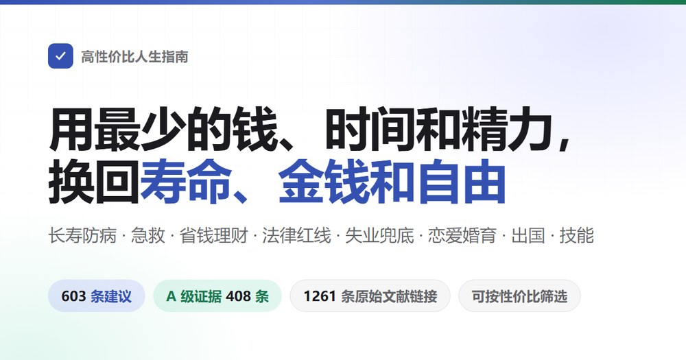

这本书的第一句话不是"愿你活得更好"，是「**不要早死**」。

我本来是抱着看养生号的警惕翻开的。结果第一页就在算账：系安全带，前排致命伤风险降 45%；戴头盔并且把扣带扣好，死亡风险降 42%；把家里的盐换成低钠盐，中国农村两万人的随机对照试验，五年内死亡低约 12%。每一条后面都跟着成本、证据等级和期刊出处，像一张报价单。

603 条，33 节，从"不要早死"一路排到"残疾之后怎么活"。作者的排序方式很冷酷：先看收益，再看花不花钱、占不占时间、要不要毅力，性价比高的放前面。所以第一节第一页是安全带，不是冥想；是烟雾报警器，不是早睡早起。

## 最划算的事，大多不体面

读到一半，我一直在想一句话：**最划算的事，大多不体面。**

系安全带不体面，因为它假定你可能会撞车；装烟雾报警器不体面，因为它假定你家可能会着火；把药盒交给别人管不体面，因为它假定你会忘。这本书通篇都在做这种假定。它不鼓励你变强，只提醒你别亏。

还有一层更不体面的：它承认自己写的很多东西，作者本人也做不到。前言里那句话我抄了下来——"这是按性价比排好的备选单，不是任务清单……作者自己也没做到其中大部分"。一句话就把"读完就焦虑"这件事卸掉了。你不用全做，挑走一两条就算数。

## 它最动人的一节不在"健康"里

真正让我坐直的是第 29 节，「遭遇重大打击之后」。

那一节开头写：亲人去世后的头一天，急性心梗发作的概率是平时的 21.1 倍；伴侣去世后 30 天内，心梗或中风的比例大约翻倍。然后它给出的话不是什么"要坚强"：

> 这几天别一个人待着，药照常吃。药盒交给别人管，别靠自己记。这几天别开长途。别靠喝酒扛过去。

数据在这里不是用来吓人的，是用来把那几天具体化的。一个人刚失去亲人，最需要的不是道理，是一句"把药盒交出去"。

## 它也承认自己算不了的

这本书的边界，作者自己也写了：它算的是概率，是"少亏"，不是"值得"。

清单防得住蠢死，防不住为什么活。它能让你的期望寿命多几年、让你少被骗几千块、让你在被欠薪的时候知道去哪投诉，但它不会告诉你为什么还要早起。这一点我很能理解——毕竟人不是一道可以优化的模型，有些东西进不了那张报价单。

## 我准备先做的三件事

读完没有立什么宏愿，只挑了三条最不体面的：

- 回家把盐换了，顺便看一眼燃气软管到期没；
- 把"打算做"写成"几点、在哪、遇到什么就做什么"，别再写"最近要开始读书"；
- 把 120、12356、12315 存进手机，希望永远用不上。

## 最后

这本书本身也挺有意思：它是一个 [GitHub 仓库](https://github.com/eternity4719/HowToLiveBetter)，正文就是数据，配一个纯静态的检索页，能按证据等级、性价比、花不花钱来筛，还带一个离线单文件版。跟我这两周在折腾的东西是同一个思路——内容即数据，不用数据库，不用后台。

如果你也只想要一份"少踩坑"的说明书，而不是一碗鸡汤，可以去找来翻。看完不必全做，挑一条换了，就不亏。
